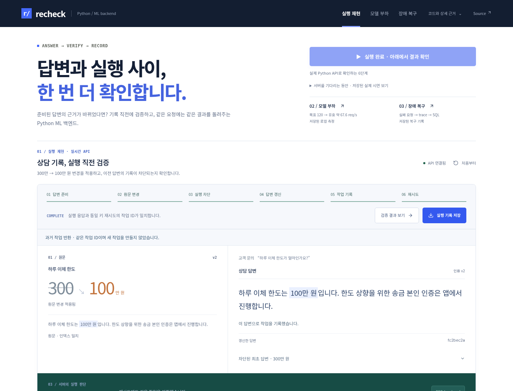
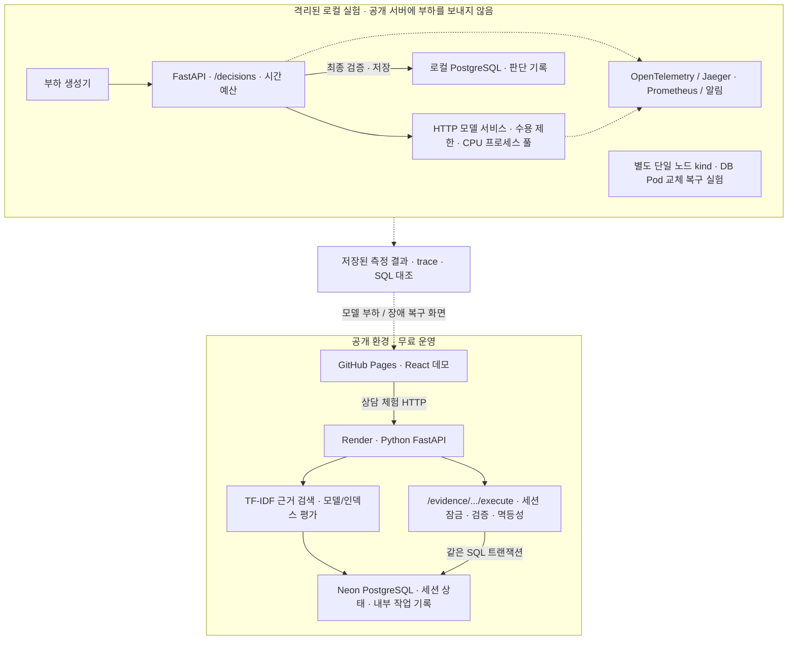

# RECHECK · 기록 직전에 다시 확인하는 Python ML 백엔드

**답변의 근거가 바뀌면 실행을 멈추고, 모델의 부하·장애까지 검증하는 Python ML 백엔드 프로젝트입니다.**

[공개 데모 바로 실행](https://sokldjs554.github.io/recheck-ml-serving/) · [실제 API 시연 영상](https://sokldjs554.github.io/recheck-ml-serving/media/recheck-walkthrough.mp4)

[](https://sokldjs554.github.io/recheck-ml-serving/)

대표 화면을 누르면 공개 데모가 열립니다. [짧은 실제 시연 영상](https://sokldjs554.github.io/recheck-ml-serving/media/recheck-walkthrough.mp4)도 확인할 수 있습니다. **로컬 Python API·SQLite에서 촬영한 저장 영상**이며 공개 서버의 현재 상태가 아닙니다. 영상은 아래 6단계와 화면 이동 후 결과 유지를 보여줍니다. 공개 데모는 무료 Python 서버·PostgreSQL에 연결하며 첫 응답이 늦어질 수 있습니다. 기다리는 동안 첫 화면에서 같은 영상을 볼 수 있습니다.

## 문제와 실행 흐름

답변을 만들 때는 맞았던 정보가 실행할 때도 맞는 것은 아닙니다. RECHECK는 **답변 생성 이후 원문이 바뀐 상황에서 오래된 답변으로 작업이 기록되는 문제**를 다룹니다. 확인이 끝난 직후 원문이 바뀌거나, 응답을 받지 못해 같은 요청을 다시 보내는 경우도 포함합니다.

대표 상황은 가상 상담의 이체 한도 안내입니다. 실제 송금이나 메시지 발송은 하지 않습니다.

1. **답변 준비:** 문서를 검색해 “하루 300만 원”이라는 답변을 준비합니다.
2. **원문 변경:** 문서의 한도를 100만 원으로 바꿉니다. 기존 답변은 보존합니다.
3. **이전 답변 차단:** 근거 버전이 달라졌으므로 `409 source_changed`를 반환하고 기록하지 않습니다.
4. **다시 준비:** 모델·인덱스 묶음을 평가·교체하고 현재 문서에서 새 답변을 준비합니다.
5. **상담 기록:** 근거 검증과 내부 작업 기록을 같은 SQL 트랜잭션에서 처리합니다.
6. **같은 키로 재시도:** 처음 기록한 작업 ID를 반환하고 중복 기록을 만들지 않습니다.

첫 화면의 **전체 과정 실행**으로 시작하거나 한 단계씩 실행할 수 있습니다. 비교·상세 화면을 다녀와도 진행 상황과 작업 ID, 로그가 유지됩니다. **같은 탭에서 새로고침해도 확인한 응답과 재시도 키를 복원**합니다. 복원만으로 요청을 보내지는 않습니다. 중간 상태는 ‘이어서 실행’으로 서버 세션부터 확인하고, 완료 상태는 저장된 차단 결과와 작업 ID를 안내합니다. 상담 답변은 **TF-IDF 검색의 근거 발췌**이며 LLM 생성이 아닙니다.

실행 로그에서 **실행 차단 / 기록·재시도**를 골라 차단 사유와 같은 작업 ID를 확인할 수 있습니다. 모델 부하는 **30초 구간별 유효·보류·거절·시간 초과**를 구분합니다. **저장 후 504가 반환된 한 건**은 실제 요청 키와 SQL 행까지 확인할 수 있습니다. 장애 복구에서는 **HTTP 응답·모델 판단·SQL 기록**을 함께 보고, 실패·오류 해제 후 trace를 공통 시간축으로 비교합니다. 이 선택은 저장된 결과를 읽으며 추가 추론을 요청하지 않습니다.

| 데모 경로 | 확인하는 내용 | 실행 방식 |
|---|---|---|
| [실행 재현](https://sokldjs554.github.io/recheck-ml-serving/#case) | 원문 변경 → 차단 → 새 기록 → 멱등 재시도 | 실제 API `/evidence/…/execute` |
| [모델 부하](https://sokldjs554.github.io/recheck-ml-serving/#serving) | CPU 모델 보호, 과부하·회복, 정합성 비용 | 저장된 로컬 `/decisions` 실험 및 별도 SQL 측정 |
| [장애 복구](https://sokldjs554.github.io/recheck-ml-serving/#recovery) | 실패 trace·로그·SQL 대조, 복구 후 추론·저장 | 저장된 로컬·Kubernetes 실험, 버튼으로 별도 공개 API 조회 |

## 전체 시스템 구조

**공개 상담 체험과 CPU 모델 부하 실험은 서로 다른 실행 경로입니다.** CPU 부하 실험의 수치를 상담 체험의 성능으로 해석하지 않습니다.



상담 경로의 핵심은 [근거 검증·작업 기록](backend/recheck/evidence.py), CPU 경로의 핵심은 [API](backend/recheck/api.py)·[모델 서비스](backend/recheck/worker.py)·[최종 검증과 저장](backend/recheck/store.py)입니다. 관측 도구와 kind는 로컬 검증 구성입니다. 실패 추적에서는 OpenTelemetry SDK의 OTLP 출력을 수집했고, SQL 영속화는 별도 조회로 대조했습니다.

## 핵심 설계 선택과 측정 결과

### 검증과 기록의 단일 트랜잭션

문서 변경과 실행이 같은 세션의 잠금을 사용합니다. 잠금 안에서 버전·삭제·만료·배포 버전을 확인하고 작업을 기록합니다. 긴 검색·평가는 잠금 밖에서 수행합니다. 같은 키의 재요청에는 과거 작업을 반환합니다.

SQLite와 PostgreSQL **각각 동일한 9개 사건 순서**를 넣은 비교에서, 오래된 결과를 허용한 횟수는 다음과 같았습니다. 중복 처리는 세 방식에 동일하게 적용했습니다.

| 방식 | 오래된 결과 허용 / 6회 | 정상 결과 오거절 / 3회 | 재시도 중복 기록 / 1회 |
|---|---:|---:|---:|
| 생성 당시 결과 신뢰 | 6 / 6 | 0 / 3 | 0 / 1 |
| 사용 직전 확인 후 별도 기록 | 5 / 6 | 0 / 3 | 0 / 1 |
| 같은 트랜잭션에서 검증·기록 | 0 / 6 | 0 / 3 | 0 / 1 |

**정합성을 지키는 비용**은 같은 세션의 직렬화와 상태 저장입니다. 별도 로컬 PostgreSQL 직접 호출 실험(54조건 × 3회, 각 4개 동기화 wave)에서 동시 8개·큰 상태·문서 변경 없음일 때, 같은 세션은 **91.89건/s·p95 86.87ms**, 서로 다른 세션은 **111.43건/s·p95 78.64ms**였습니다. HTTP 처리량이 아니며 JSON이나 잠금 하나를 유일한 병목으로 단정하지 않았습니다.

[정합성 계약](docs/action-contract.md) · [세 방식 비교 조건](docs/safety-case-study.md) · [동시 요청·잠금 시간 초과 비교](docs/action-comparison-audit.md) · [경합·변경 빈도·상태 크기별 비용](docs/consistency-costs.md)

### CPU 연산 격리와 요청 수용 제한

API → HTTP 모델 서비스 → CPU 추론 프로세스 2개 → PostgreSQL을 연결했습니다. 수용량과 시간 예산을 제한하고, 시간 예산이 끝나도 이미 시작한 CPU 작업은 실제 종료할 때까지 슬롯을 점유하게 했습니다. 비용은 프로세스 메모리와 거절·보류되는 요청입니다.

**공유 호스트(CPU quota 4코어)의 격리된 로컬 실험**, 5초 워밍업 이후 **180초** 동안 `30초 정상 10 → 30초 과부하 120 → 30초 정상 10 req/s`를 두 번 반복했습니다.

| 관측 | 결과와 의미 |
|---|---|
| 과부하 목표 요청률 | **120 req/s 투입**. 유효 처리량을 뜻하지 않음 |
| 과부하 유효 응답률 | **약 67.6 req/s**. 예정 시점부터 300ms 이내 도착한 유효 결과 기준 |
| 과부하 두 구간 | 7,200건 중 유효 4,072 · 보류 2,983 · HTTP 429 144 · HTTP 504 1 |
| 정상·복귀 네 구간 | 각 300 / 300건 유효. 복귀 직후의 5초 창 2개가 조건을 만족해 10초 시점에 회복 확인 |
| 자원 비용 | API·모델 최대 합산 RSS 652.6 MiB, 유효 응답당 CPU 41.0ms. DB·부하 생성기는 제외 |
| 응답과 SQL | 워밍업 포함 HTTP 200 기록 8,305건 일치. 별도 504 한 건도 이미 저장되어 SQL 총 8,306건. 중복·누락·불일치·pending 0건 |

회복 확인 시점은 실제 회복에 걸린 시간과 다릅니다. 세션 만료·기록 개수 제한에는 도달하지 않았습니다. 측정 시간은 **180초**입니다. 프로세스 격리 효과는 기존 worker 단독 비교로 확인하며 측정 경계가 다른 수치를 합치지 않습니다.

[지속 부하·전체 요청·자원·SQL 원본](docs/fullpath-sustained.md) · [프로세스 격리 비교](docs/compute-experiments.md) · [학습 모델 인계 검증](docs/model-handoff.md)

### HTTP 응답·모델 결과·SQL 기록의 대조

로컬 모델 오류 요청 하나의 API→모델 trace·예외 로그·`model_unavailable` 응답을 연결하고, 반환 receipt를 PostgreSQL에서 대조했습니다. 오류를 해제한 다음 요청의 정상 추론·저장도 확인했습니다. HTTP 200인 보류 응답을 유효 추론으로 세지 않습니다.

별도 단일 노드 kind 실험에서는 **DB Pod 교체 → readiness 실패/503 탐지 → 같은 PVC로 재기동 → 정상 추론·새 기록·기존 기록 보존**을 확인했습니다. 첫 실패와 첫 성공의 관측 간격은 2.502초로 관측됐습니다. `fence.commit` span은 ORM 커밋 전에 끝나므로 SQL 커밋 시간으로 해석하지 않습니다.

[실패 trace·로그·SQL과 복구 절차](docs/failure-walkthrough.md) · [관측 구성](docs/operations.md) · [Kubernetes 검증](docs/kubernetes.md)

공개 상담 실행에도 **차단·새 기록·같은 작업 반환·잠금 실패·DB 실패**를 관측합니다. 잠금 획득과 ORM flush/commit 호출을 구분하고, HTTP 연결이 끊겨도 최종 SQL 결과를 로그·trace로 확인합니다. [계측 경계와 실제 검증](docs/evidence-execution-observation.md)

**측정 버전:** 위 180초 부하·세션 경합·실패 trace는 2026-10-12 측정이며 `0b99e35`의 원본 코드 해시와 일치합니다. 이번 제출 버전의 재측정값이 아닙니다. worker 단독 200ms 비교는 2026-10-09 KST, 별도 경로입니다. [날짜·커밋 대조](docs/release-2026-10-18.md#측정-시점과-제출-버전)

## 본인 역할과 AI 활용

AI와 주제 후보를 비교한 뒤 최종 주제와 진행 방향을 결정했습니다. 초기 결과물을 검토하며 필요한 기능을 추가로 요구하고, 기존 기능의 동작과 구현 범위를 조정했습니다. 의도한 결과가 나오지 않을 때는 관련 프로젝트와 구체적인 예시로 수정 방향을 전달했고, 변경된 결과를 검토해 반영 여부를 판단했습니다.

**코드 작성과 데모 제작은 AI가 주로 담당했습니다.** 위 기술 설명과 측정 결과는 프로젝트에 구현·기록된 내용이며, 제가 직접 설계·코딩·실험을 수행했다는 개인 기여 주장과 구분합니다.

## 실행 방법

```sh
git clone https://github.com/sokldjs554/recheck-ml-serving.git
cd recheck-ml-serving
docker compose up --build
# http://localhost:8000
```

<details>
<summary>Docker 없이 실행 · 프런트 개발 · 테스트</summary>

```sh
python3.12 -m venv backend/.venv
backend/.venv/bin/pip install -r backend/requirements.txt
backend/.venv/bin/python scripts/serve_demo.py
# http://localhost:8000
```

```sh
PYTHONPATH=backend backend/.venv/bin/python -m pytest backend/tests -q
npm --prefix demo ci
npm --prefix demo test
npm --prefix demo run dev
```

프런트 수정 후 Node 24에서 `python scripts/build_demo.py`로 서버용 정적 번들을 갱신합니다. CI는 PostgreSQL·프런트 테스트, 번들 일치, 공개 주소의 브라우저 동작을 확인합니다. [검증 명령과 기록](docs/verification.md)

</details>

부하 실험은 위 상세 문서의 명령으로 격리된 로컬 환경에서만 재현합니다. **공개 무료 서버에는 부하를 보내지 않습니다.**

## 검증과 상세 자료

2026-10-18 로컬 회귀: 백엔드 **160개**·프런트 **61개** 통과. 공개 주소의 Chromium·macOS WebKit 검사 **78개** 통과. 실행별 환경·CI·화면 캡처는 [제출 버전 검증 기록](docs/release-2026-10-18.md)에 연결합니다.

공개 체험은 가상 상담 문서와 Neon PostgreSQL을 사용합니다. 무료 서버의 첫 응답에는 대기 시간이 있을 수 있으며, 세션은 생성 후 1시간 동안 유지됩니다. 부하·장애 복구 화면에는 조건을 함께 표시한 로컬 측정 결과를 제공합니다.

[이번 변경·검증·제출 반영 사항](docs/release-2026-10-18.md) · [화면 개편과 시연](docs/interface-update-2026-10-17.md) · [설계와 공고 대응](docs/job-coverage.md) · [기술 선택](docs/decisions.md) · [지속 부하 측정](docs/fullpath-sustained.md) · [장애 추적과 복구](docs/failure-walkthrough.md) · [공개 운영 점검](docs/public-runtime.md) · [전체 검증](docs/verification.md)
