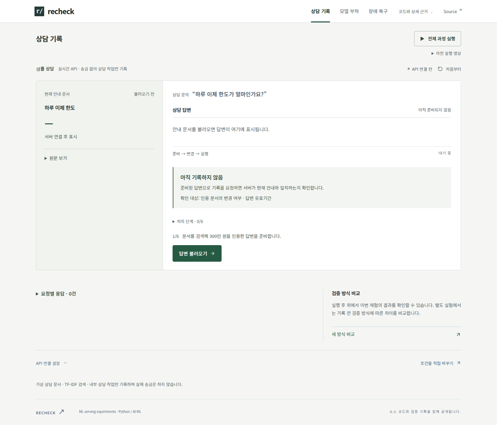
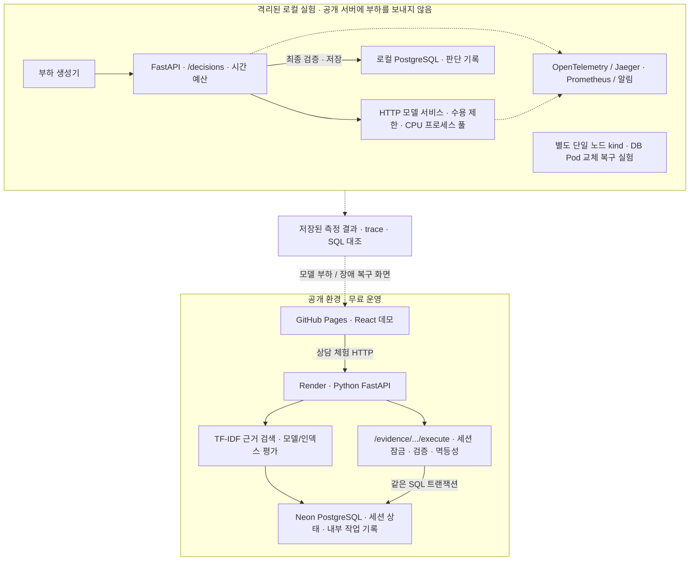

# RECHECK

**답변이 인용한 문서를 기록 직전에 다시 확인하는 Python ML 백엔드입니다.** 문서 변경에 따른 오래된 답변 차단, 같은 요청의 중복 기록 방지, 별도 CPU 모델의 부하·장애 처리를 구현했습니다.

[공개 화면 열기](https://sokldjs554.github.io/recheck-ml-serving/) · [실제 API 시연 영상 — 이전 UI](https://sokldjs554.github.io/recheck-ml-serving/media/recheck-walkthrough.mp4)

[](https://sokldjs554.github.io/recheck-ml-serving/)

대표 화면은 이번 UI의 공개 배포 캡처입니다. 영상은 **2026-10-18의 이전 UI를 로컬 Python API·SQLite로 실행한 촬영본**입니다. 현재 배치·문구와는 다릅니다. 무료 공개 API의 첫 연결이 늦을 때 화면에서 저장된 영상을 먼저 볼 수 있습니다.

## 확인할 수 있는 동작

답변 생성과 실제 기록 사이에 원문이 바뀌면, 한때 맞았던 답변이 잘못된 작업으로 남을 수 있습니다. 검사와 기록을 따로 처리하면 검사 직후의 변경도 놓칠 수 있습니다. RECHECK는 이 틈과 응답 유실 뒤의 재시도를 다룹니다.

대표 사례는 **가상 상담의 하루 이체 한도 안내**입니다. 실제 송금·메시지 발송은 하지 않습니다. 답변은 TF-IDF로 찾은 근거 발췌이며 LLM 생성이 아닙니다.

| 사용자의 행동 | 화면에서 확인하는 결과 |
|---|---|
| 답변 불러오기 | 현재 안내를 인용한 300만 원 답변 |
| 안내 한도를 100만 원으로 변경 | 현재 문서는 100만 원, 준비된 답변은 여전히 300만 원 |
| 이 답변으로 기록 요청 | 인용 문서가 바뀌어 기록 거절. 새 작업 없음 |
| 변경된 안내로 답변 갱신 → 새 답변으로 기록 요청 | 100만 원 답변으로 내부 상담 작업 기록 |
| 같은 요청 재시도 | 새 작업을 만들지 않고 동일 작업 ID 반환 |

답변 바로 아래의 행동 버튼으로 한 단계씩 진행합니다. 상단의 **전체 과정 실행**은 같은 흐름을 자동으로 진행하는 보조 버튼입니다. 두 버튼은 동일한 실행 상태를 공유해 진행 중 중복 시작을 막습니다. 완료 후 **이번 실행 결과**에서 차단·기록·재시도 결과를 함께 확인하고, **요청별 응답**을 펼치면 원본 응답을 읽거나 JSON으로 저장할 수 있습니다.

화면 이동 후에도 진행 상황·작업 ID·로그를 유지합니다. 같은 탭의 새로고침은 **브라우저에 저장된 이전 응답**을 복원하며 자동 API 요청을 보내지 않습니다. 중간 상태에서 계속 실행하면 먼저 서버 세션을 확인합니다. 완료 기록의 복원은 현재 서버에서 다시 검증했다는 뜻이 아닙니다.

| 화면 | 근거와 실행 범위 |
|---|---|
| [상담 기록](https://sokldjs554.github.io/recheck-ml-serving/#case) | 사용자가 실행하는 실제 API `/evidence/…/execute`. 세 방식 비교는 별도의 저장 자료 |
| [모델 부하](https://sokldjs554.github.io/recheck-ml-serving/#serving) | 과거 로컬 `/decisions` 부하 실험. 구간별 유효·보류·거절·시간 초과와 SQL 대조 |
| [장애 복구](https://sokldjs554.github.io/recheck-ml-serving/#recovery) | 저장된 실패·복구 trace와 SQL, 별도 공개 운영 상태 조회 버튼 |

추가 조건 실험의 브라우저 시뮬레이션은 실제 API와 구분해 표시합니다.

## 시스템 구조와 요청 흐름

**공개 상담 체험과 CPU 모델 부하 실험은 서로 다른 경로입니다.** CPU 부하 수치를 상담 체험의 응답 속도로 사용하지 않습니다.



상담 경로의 핵심은 [근거 검증·작업 기록](backend/recheck/evidence.py), CPU 경로의 핵심은 [API](backend/recheck/api.py)·[모델 서비스](backend/recheck/worker.py)·[최종 검증과 저장](backend/recheck/store.py)입니다. 관측 도구와 kind는 로컬 검증 구성입니다. 실패 추적에서는 OpenTelemetry SDK의 OTLP 출력을 수집했고, SQL 영속화는 별도 조회로 대조했습니다.

## 기술 선택과 비용

| 선택 | 현재 구현에서 얻는 효과 | 감수한 비용 |
|---|---|---|
| 세션 잠금 안에서 검사·기록 | 검사 직후 변경되는 틈을 막고 같은 키의 기존 작업 반환 | 같은 세션 요청의 직렬화, 잠금 대기·시간 초과 |
| 세션 전체 JSON 저장 | 작은 사례의 문서·답변·작업을 함께 재현 | 상태 복사·직렬화·쓰기량. 조회도 잠금 경로 사용 |
| API와 CPU 모델 프로세스 분리 | 무거운 계산과 요청 처리의 실행 경계 분리 | 프로세스 시작·모델 복제 메모리·HTTP/IPC 비용 |
| 실행·대기 슬롯과 시간 예산 제한 | 무한 대기열 억제. 응답이 끝나도 CPU 종료 전까지 슬롯 유지 | 수용 한도를 넘는 요청의 거절·보류. 실행 중 CPU 즉시 중단 불가 |
| 저장 결과와 HTTP 응답 구분 | 응답 유실·시간 초과 뒤 같은 키로 실제 기록 확인 | 키 보존, 불명 상태·세션 만료 처리 필요 |

설명은 현재 코드의 선택을 분석한 것이며 지원자의 과거 의사결정을 추정하지 않습니다. [코드 위치·대안·제약](docs/decisions.md) · [공개 상담의 잠금·저장·취소 관측](docs/evidence-execution-observation.md)

## 측정 결과와 조건

아래는 **과거 실험**입니다. 이번 UI 변경에서 처리량을 재측정하지 않았습니다. 날짜는 KST이며, 소스 대조 커밋과 자료 보관 커밋은 [측정 출처](docs/measurement-provenance.md)에서 구분합니다.

| 질문 | 조건·측정 시점·소스 대조 | 관측 결과와 원본 |
|---|---|---|
| 검사와 기록을 묶으면 무엇이 달라지는가? | 2026-10-12 00:34, `976ebb7`. SQLite·PostgreSQL 각각 고정 사건 순서 | 오래된 근거 6회 중 별도 검사·기록은 5회 허용, 동일 트랜잭션은 0회. 준비된 사례 결과이며 운영 사고율 아님. [세 방식 비교](docs/safety-case-study.md) |
| 세션 경합의 비용은? | 2026-10-12 15:08, `0b99e35`. PostgreSQL 직접 호출, 동시 8개·큰 상태·문서 변경 없음 | 같은 세션 91.89건/s·p95 86.87ms, 서로 다른 세션 111.43건/s·p95 78.64ms. HTTP 처리량 아님. [54조건 × 3회 비용 측정](docs/consistency-costs.md) |
| 과부하에서 얼마를 유효하게 처리했는가? | 2026-10-12 14:59, `0b99e35`. 공유 호스트 CPU quota 4코어, CPU worker 2개→PostgreSQL. 5초 워밍업 후 180초, 30초씩 정상10→과부하120→정상10 req/s를 2회 | 과부하 **목표 투입 120 req/s**, 예정 시점부터 **300ms 이내 유효 응답 약 67.6 req/s**. 과부하 7,200건=유효4,072+보류2,983+429 144+504 1. [전체 요청·자원·SQL](docs/fullpath-sustained.md) |
| 응답 실패는 저장 실패인가? | 위 부하 실험의 504 1건, 워밍업 포함 SQL 대조 | 504도 이미 저장되어 SQL 8,306건, HTTP 200 기록은 8,305건. 중복·누락·불일치·pending 0. 해당 부하 실험에서 재시도는 실행하지 않음. [원본 요청 키와 SQL](docs/fullpath-sustained.md) |
| 모델 장애 위치와 복구를 확인할 수 있는가? | 2026-10-12 14:55, `0b99e35`. 로컬 오류 주입 후 해제 | 실패 API→모델 trace·예외 로그·SQL 대조 후 정상 추론·저장 확인. `fence.commit`은 실제 SQL commit 시간이 아님. [실패부터 복구까지](docs/failure-walkthrough.md) |

180초 실험의 정상·복귀 네 구간은 각 300/300건이 유효했습니다. 복귀 후 5초 창 두 개를 확인한 **10초 시점**은 회복 확인 시점이지 정확한 회복 소요 시간이 아닙니다. API·모델 최대 합산 RSS 652.6 MiB, 유효 응답당 CPU 41.0ms는 DB와 부하 생성기를 제외한 비용입니다. 장기 처리 용량이나 SLA를 의미하지 않습니다.

[프로세스 격리의 별도 비교](docs/compute-experiments.md) · [단일 노드 kind 복구](docs/kubernetes.md) · [관측 도구 구성](docs/operations.md). kind의 2.502초는 **2026-10-09 01:28~01:30 KST 과거 실험의 첫 실패~첫 성공 관측 간격**이며 상용 고가용성 실적이 아닙니다.

## 실행·재현

```sh
git clone https://github.com/sokldjs554/recheck-ml-serving.git
cd recheck-ml-serving
docker compose up --build
# http://localhost:8000
```

<details>
<summary>Docker 없이 실행 · 프런트 개발 · 테스트</summary>

```sh
python3.12 -m venv backend/.venv
backend/.venv/bin/pip install -r backend/requirements.txt
backend/.venv/bin/python scripts/serve_demo.py
# http://localhost:8000
```

```sh
PYTHONPATH=backend backend/.venv/bin/python -m pytest backend/tests -q
npm --prefix demo ci
npm --prefix demo test
npm --prefix demo run dev
```

프런트 수정 후 Node 24에서 `python scripts/build_demo.py`로 서버용 정적 번들을 갱신합니다. CI는 PostgreSQL·프런트 테스트, 번들 일치, 공개 주소의 브라우저 동작을 확인합니다. [검증 명령과 기록](docs/verification.md)

</details>

부하 실험은 위 상세 문서의 명령으로 격리된 로컬 환경에서만 재현합니다. **공개 무료 서버에는 부하를 보내지 않습니다.**

| 확인할 자료 | 바로가기 |
|---|---|
| 이번 UI 변경 전후·배포 버전·브라우저 검사·재확인 과제 | [화면과 검증 근거](docs/usability-feedback-2026-10-19.md#작업-흐름-재구성) |
| 서버 설계·서빙·추적 요구와 구현 위치 | [공고 대응](docs/job-coverage.md) |
| 동일 키·동시 요청·잠금 실패 | [정합성 계약](docs/action-contract.md) · [동시성 비교](docs/action-comparison-audit.md) |
| 검증 실행 방법과 기존 운영 기록 | [검증 명령](docs/verification.md) · [공개 운영 점검](docs/public-runtime.md) |

## 본인 역할과 AI 활용

AI와 주제 후보를 비교한 뒤 최종 주제와 방향을 결정했습니다. 요구사항을 구체화하고 기능 추가·범위 조정·수정 요청을 했으며, 관련 프로젝트와 예시를 전달하고 변경 결과의 반영 여부를 검토했습니다.

**코드 작성과 데모 제작은 AI가 주로 담당했습니다.** 프로젝트에 구현된 기술과 기록된 실험은 위에서 설명한 역할과 구분하며, 확인되지 않은 직접 설계·코딩·실험 경험을 개인 기여에 포함하지 않습니다.

## 현재 범위

- 무료 API는 첫 응답이 지연될 수 있습니다. 배포 검증과 이후 정기 점검은 구분하며 [실패 표본도 보존](docs/public-runtime.md)합니다.
- 공개 체험은 가상 데이터·내부 작업 기록이며 세션은 생성 후 1시간입니다. 새로고침 복원은 같은 탭의 브라우저 저장 범위입니다.
- 자동화 검사는 기능 회귀 근거입니다. **비전공자 친구 1명의 답변을 반영했으며 수정 후 사람의 재확인은 대기 중**입니다. 성공률·이해도 향상·고객 실적으로 확대하지 않습니다.
- 브라우저 자동화의 모바일 크기·WebKit 검사는 실제 iPhone Safari 기기 검사와 다릅니다.
