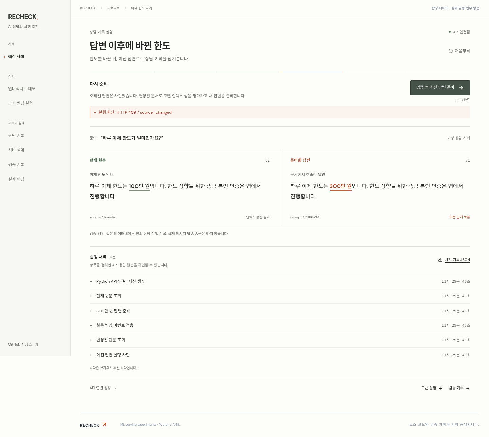
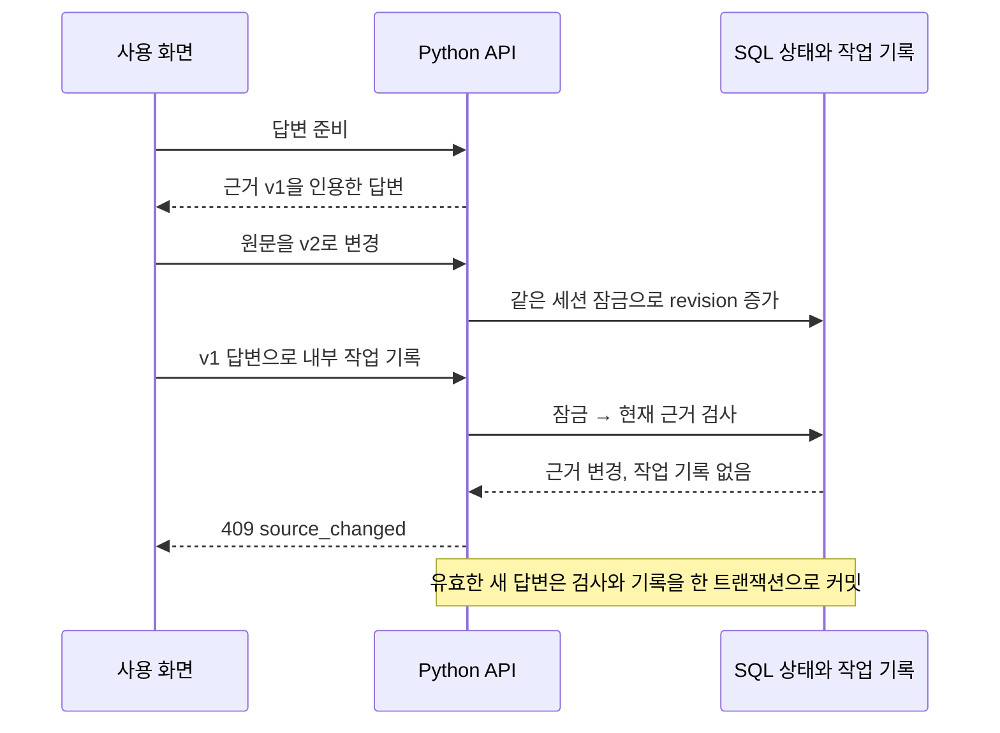

# RECHECK

**AI 결과가 만들어진 뒤 근거가 바뀌었다면, 그 결과로 작업을 실행해도 될까요?**

RECHECK는 이 질문을 Python 서버, 실제 SQL 트랜잭션, 직접 조작하는 데모로 검증하는 프로젝트입니다.
가상 상담 문서의 이체 한도를 300만 원에서 100만 원으로 바꾸면, 예전 답변을 사용하는 작업은 거절됩니다.
새 근거로 답변을 다시 준비한 뒤에만 내부 작업 기록이 생깁니다.

[직접 체험하기](https://sokldjs554.github.io/recheck-ml-serving/) · [실제 Python 호스트](https://recheck-ml-serving.onrender.com/) · [세 방식의 비교 실험](docs/safety-case-study.md) · [핵심 코드](backend/recheck/evidence.py)

## 빠르게 살펴보기

**Python ML 백엔드의 최신성·동시성·장애 경계를 재현하고 검증합니다.**

- **문제:** 생성 시점에는 맞았던 결과가 실행 시점에는 오래된 정보가 되는 상황.
- **핵심 선택:** 근거 검증과 내부 작업 기록을 같은 SQL 트랜잭션으로 처리하고, 재시도는 같은 작업 ID로 수렴.
- **검증:** 같은 9개 사건 순서를 SQLite·PostgreSQL에서 각각 비교하고, 실제 잠금 경쟁·취소·과부하·복구를 별도로 재현.

[실제 API 데모](https://sokldjs554.github.io/recheck-ml-serving/) · [기술 선택과 비교 근거](docs/safety-case-study.md)



## 먼저 체험할 한 가지

첫 화면 **핵심 사례**에서 버튼을 순서대로 누릅니다. 결과는 실제 Python API·검색·DB에서 옵니다.

1. **답변 준비:** 가상 문서에서 300만 원이라는 근거를 검색합니다.
2. **원문 변경:** 한도를 100만 원으로 바꿉니다. 이미 만들어진 답변은 그대로 보존됩니다.
3. **이전 답변 실행:** 서버가 버전 차이를 확인해 작업 기록을 거절합니다.
4. **새 근거로 다시 준비:** 모델·인덱스 묶음을 평가·교체하고 현재 문서를 검색합니다.
5. **내부 작업 기록:** 근거 검증과 작업 기록을 한 DB 트랜잭션으로 처리합니다.
6. **같은 요청 재시도:** 같은 작업 ID를 반환하며 중복 기록이 생기지 않습니다.

실제 메시지를 발송하거나 송금하지 않습니다. 출력은 TF-IDF 검색의 근거 발췌이며 LLM 생성이 아닙니다.
첫 연결은 무료 호스트 시작으로 늦어질 수 있습니다. 연결 실패를 성공이나 브라우저 시뮬레이션으로 바꾸지 않습니다.
기존 **인터랙티브 데모**는 별도로 명시된 브라우저 시뮬레이션이며 **근거 변경 실험**은 자유롭게 조작하는 실제 API 실험입니다.

## 핵심 기술 판단: 확인과 실행 사이의 빈틈

사용 직전 확인만 추가해도 충분할 것 같지만, 확인이 끝난 뒤 기록하기 전에 문서가 바뀔 수 있습니다.
그래서 내부 작업에 대해서는 문서 변경과 같은 세션 행 잠금을 사용하고, 버전·삭제·만료·배포 버전을 확인한 뒤
같은 트랜잭션에서 불변 작업 기록을 남깁니다. 모델 검색과 평가 같은 긴 작업은 이 잠금 밖에서 수행합니다.



이는 새 동시성 기법의 발명이 아닙니다. 모델/인덱스 교체, 변경된 근거, 멱등 재시도, 실패 기록을
한 흐름에서 재현하고 보장 범위를 코드로 확인하는 사례입니다.
[트랜잭션·멱등성 계약과 한계](docs/action-contract.md)

## 같은 사건을 넣으면 무엇이 달라지는가

SQLite와 PostgreSQL에서 각각 동일한 **9개 고정 사건 순서, 방식별 10회 제출**을 실행했습니다.
생성 결과 신뢰와 검사 후 실행에도 같은 멱등 처리를 적용해, 검증 시점의 차이만 비교했습니다.

| 방식 | 오래된 결과 허용 / 6회 | 정상 결과 오거절 / 3회 | 중복 기록 / 1회 재시도 |
|---|---:|---:|---:|
| 생성 당시 결과 신뢰 | 6 / 6 | 0 / 3 | 0 / 1 |
| 사용 직전 확인 후 별도 기록 | 5 / 6 | 0 / 3 | 0 / 1 |
| 검증과 기록을 한 트랜잭션으로 | 0 / 6 | 0 / 3 | 0 / 1 |

두 DB에서 각각 관측된 결과이며 분모를 합치지 않았습니다. 수정·삭제·만료·모델 교체·본문이 돌아오는 ABA·무관한 문서 변경·재시도를 포함합니다.
별도의 실제 동시성 테스트는 변경/실행 두 가지 잠금 순서와 같은 키의 동시 제출을 검사합니다.

[조건과 전체 결과](docs/safety-case-study.md) · [사건별 원본 JSON](docs/evidence/safety-evaluation.json) · [재현 스크립트](scripts/evaluate_safety.py) · [동시성 테스트](backend/tests/test_evidence_actions.py)

이 수치는 제한된 반례 검증입니다. 실서비스 사고율, 검색 정확도, 일반적인 안전성, 부하 처리 성능으로 해석하지 않습니다.

## 더 깊이 볼 근거

| 질문 | 구현·실험 | 범위 |
|---|---|---|
| 모델이 응답하는 사이 입력이 바뀌면? | [추론 예약·최종 검증](backend/recheck/store.py), 멱등 키, 불변 판단 기록 | 실제 금융 원장과는 연결하지 않음 |
| 요청을 취소하면 CPU도 멈추는가? | [CPU 격리 비교](docs/compute-experiments.md), 실행 슬롯 보존, 지연·goodput·RSS | 합성 CPU 모델, 짧은 공유 호스트 실험 |
| 모델과 인덱스가 서로 다르면? | [실제 검색·배포 게이트](docs/evidence-release.md) | 가상 문서 4개, 일반 검색 품질 증거 아님 |
| 장애와 복구가 보이는가? | [OpenTelemetry·알림](docs/operations.md), [Kubernetes 복구](docs/kubernetes.md) | 단일 호스트 클러스터, DB 교체 오류도 공개 |
| 사람이 설명 없이 이해하는가? | [사용성 조사 절차](docs/usability-protocol.md) | **실제 참여자 조사 미수행** |

## 실행과 재현

```bash
git clone https://github.com/sokldjs554/recheck-ml-serving.git
cd recheck-ml-serving
docker compose up --build
# http://localhost:8000
```

Python으로 실행하려면:

```bash
python3.12 -m venv backend/.venv
backend/.venv/bin/pip install -r backend/requirements.txt
backend/.venv/bin/python scripts/serve_demo.py
# http://localhost:8000
```

```bash
PYTHONPATH=backend backend/.venv/bin/pytest backend/tests -q
backend/.venv/bin/python scripts/evaluate_safety.py --help
cd demo
npm ci
npm test
npm run build
```

프런트 수정 후 Node 24에서 `python scripts/build_demo.py`로 서버용 정적 번들도 갱신합니다.
CI는 PostgreSQL 테스트, 프런트 테스트, 정적 번들 일치, 공개 주소의 브라우저 동작을 확인합니다.
[전체 검증 기록](docs/verification.md)

## 개발 방식

AI와 협업해 구현한 프로젝트입니다. 설계 선택과 보장 범위는 코드·비교 실험·실행 기록으로 확인할 수 있습니다.
[기술 선택](docs/decisions.md) · [조사 출처와 한계](docs/research.md)

## 보장하지 않는 것

실제 은행 정책·거래·고객 데이터, 외부 업무 실행의 원자성, GPU/LLM 운영, 장기간 SLA,
고객 채택·사업 성과·합격 확률을 주장하지 않습니다. 공개 서버는 인증 없는 제한된 가상 실험이며
임시 SQLite와 만료되는 세션을 사용합니다. 이미 기록한 작업은 이후 근거가 바뀌어도 과거 기록으로 남습니다.

라이선스: MIT. 번들 폰트는 동봉된 SIL Open Font License를 따릅니다.
