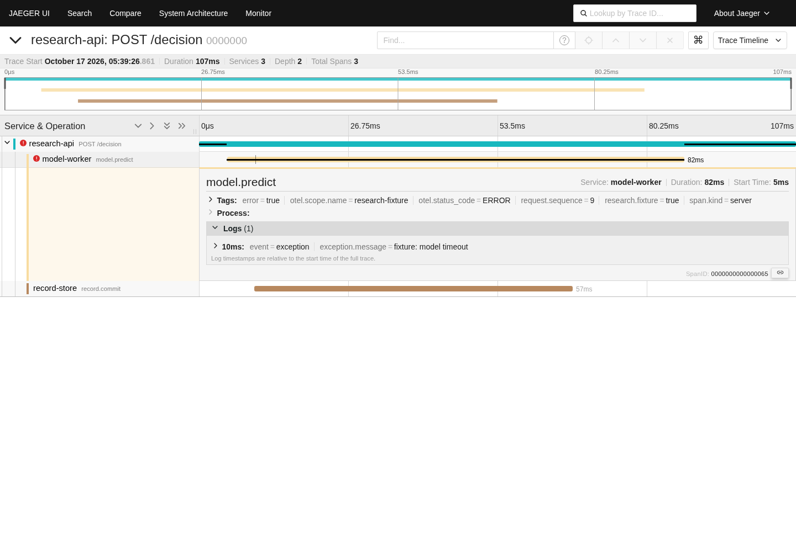
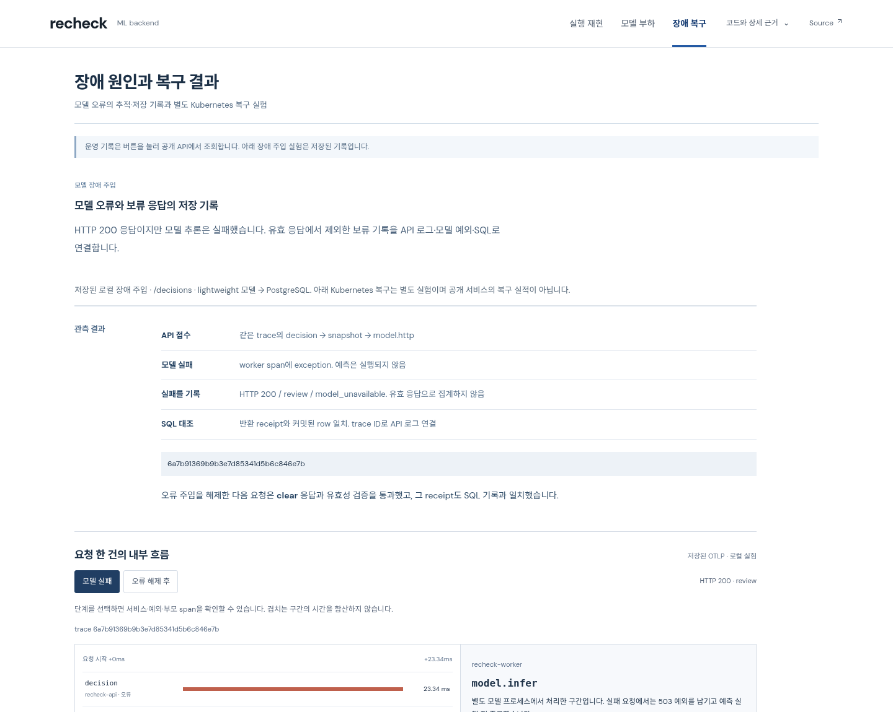

# RECHECK 심층 비교 조사: 코드·데모·화면·성능

조사일 2026-10-17 UTC. RECHECK 기준은 최신 원격과 일치한 **`ddfb7ccfeba0b4ff36e920cd2cf626d4e19c240c`**다. 이 문서는 이전의 제한된 [비교 조사](comparative-research-2026-10.md)를 확장·정정한다. **조사와 개선 제안이며, 제안한 UI를 구현했다고 주장하지 않는다.**

## 결론부터

RECHECK의 다음 업그레이드는 새 기술 이름이나 로그 필터를 더하는 것보다 **한 요청의 결과 → 판단 근거 → 실패 구간 → 저장 여부를 한 문맥에서 확인하는 작업 화면**에 집중해야 한다. 지금도 정합성 체험·180초 부하 실험·trace·SQL 원본이 있지만, 설명과 근거가 길게 이어져 평가자가 연결을 찾아야 한다.

이번에는 GitHub README만 읽지 않았다. 외부 10개 프로젝트의 소스·테스트·측정 조건·공식 화면 자료를 나눠 조사하고, **Jaeger를 실제 로컬 실행**, **Evidently 공식 저장 보고서를 실제 브라우저 조작**했다. RECHECK 최신 배포 산출물도 PC·모바일에서 직접 확인했다. 다만 아래 모든 프로젝트의 공개 데모와 영상을 전부 조작·재생한 것은 아니다.

- [실제 조작·PC/모바일 화면 보고서](research/2026-10-17/browser-audit.md)
- [서빙 소스·테스트·벤치마크 4개 심층 감사](research/2026-10-17/serving-audit.md)
- [Langfuse·promptfoo 화면·상태·테스트 감사](research/2026-10-17/trace-eval-audit.md)
- [밥벌이·Phoenix·Evidently 발표·공식 화면 감사](research/2026-10-17/presentation-audit.md)

## 공고와 연결하는 기준

[토스뱅크 ML Backend Engineer 공고](https://toss.im/career/job-detail?job_id=6600650003)는 공통 AI 백엔드, Python 등 서버 구현·운영, 무거운 연산과 높은 요청량에서의 안정성, 분산 환경의 장애 추적, 설계 이유와 구현 비용을 중시한다. 화면의 화려함이나 모델 수로 평가를 대체하지 않는다. 공개 도구가 토스뱅크 합격자의 프로젝트라는 뜻도 아니다.

비교 축은 ① 요청의 수용·대기·취소 계약 ② 장애와 복구 의미 ③ 성능 숫자의 분모·환경 ④ 첫 화면과 행동 ⑤ 결과에서 원본으로 가는 흐름 ⑥ 빈 결과·실패·로딩 ⑦ 타이포·상태색·간격 ⑧ 모바일이다.

## 조사 대상과 실제 확인 수준

**소스 확인은 실행 성공이 아니며, 공식 이미지 확인은 직접 앱 조작이 아니다.** 현재 소스와 과거 이미지가 같은 버전이라는 보장도 없다. 고정 SHA·파일별 링크는 각 상세 문서와 manifest에 있다.

| 대상 / GitHub | 확인한 기능·코드 | 화면·실행 확인 | RECHECK에 유효한 비교 |
|---|---|---|---|
| [BentoML](https://github.com/bentoml/BentoML/tree/517b343b81aeb0b01bbd908e58e53ad9c12ef7eb) | dispatcher, HTTP concurrency/timeout, 실제 e2e 테스트, benchmark 집계 | 이번에는 소스 중심. BentoCloud 실행 안 함 | 배치 크기·대기 상한·HTTP 수용 한도는 별개. 무조건 batching 도입하지 않음 |
| [Ray Serve](https://github.com/ray-project/ray/tree/f178b1887d2f9bb43a323678dc54c14aae7378be) | router, backpressure, disconnect·timeout·취소 전파 테스트 | 공식 실행 예제·테스트 코드, cluster/dashboard 실행 안 함 | 대기 중 취소/실행 중 취소/CPU 종료를 나눠 설명 |
| [MLServer](https://github.com/SeldonIO/MLServer/tree/a325e523b5a580d49aeb06e19e73e4a90176b63b) | process pool, worker stop, batch queue, k6 CI | 로컬 서버·소개 영상 재생 안 함 | worker 재시작과 실패 요청 재실행은 다름 |
| [ml-inference-service](https://github.com/kevin-sparkflow/ml-inference-service/tree/c200bcb4721c4428a9bfe808ca8a61648a2b16f6) | gateway/worker, Redis Streams, pending reclaim, Lua fencing, Locust raw | 공개 UI 주소 확인 못함. 스택 실행 안 함 | 202 작업 접수와 실제 완료 분리, 소유권 fencing·재처리 비용 |
| [Langfuse](https://github.com/langfuse/langfuse/tree/e3a2bee2a2c048adf29b8d8a18b29bd4a8bf8ac3) | tree/timeline 선택·가상화·안정 ID·모바일 sheet·layout 테스트 | 공식 timeline PNG 직접 열람. 공개 데모는 지역 선택/로그인 경로까지, 실제 앱 클릭 안 함 | 목록·시간축·상세가 같은 선택을 공유하는 구조 |
| [promptfoo](https://github.com/promptfoo/promptfoo/tree/79011700b4cb544ddd9267565571a1d42d3a3051) | 결과 matrix, 필터·분모·pagination, 상세/replay, 테스트·benchmark | 공식 viewer PNG 직접 열람, 웹 문서/공개 보고서 내용 확인. 앱 직접 실행 안 함 | 같은 입력의 다른 결과와 판정 이유를 나란히 보기 |
| [Phoenix](https://github.com/Arize-ai/phoenix/tree/c9a3087027fedff23c32b083534d0a16bcce1a25) | trace page·empty/filter error·상세 코드 | 공식 RAG GIF 5프레임·평가 PNG 직접 열람. 공개 앱 조작 안 함 | HTTP/trace 성공과 답변 품질 실패를 동시에 표현. 공개 소스이며 현재 ELv2 라이선스 구분 |
| [Evidently](https://github.com/evidentlyai/evidently/tree/34771fe41c08ca074d96a52aaf4a45cd640cbaf5) | loading/error/theme, 공식 Report/Dashboard GIF | GIF 2개에서 10프레임 열람 + **v0.4.40 공식 HTML 2개 로컬 조작**, 최신 Cloud 조작 아님 | 요약의 분모를 유지하며 실패 값·기대 값·분포로 내려가기 |
| [Jaeger](https://github.com/jaegertracing/jaeger/tree/v1.66.0) | 실제 OTLP ingest→search API→trace UI | **v1.66.0 로컬 실행**, 합성 trace12개, 검색·오류·로그·뒤로가기·모바일 | 시간축에서 바로 서비스·예외 확인. 최신 공개 HotROD 실행은 아님 |
| [밥벌이 / SKN27](https://github.com/SKNETWORKS-FAMILY-AICAMP/SKN27-FINAL-1Team/tree/2eaca8d78c53ed0c88f1af76c27ba27e3dd58d1c) | README, home/OCR 화면 상태·CSS, 상세 평가 문서 | 공식 PC/모바일 배경 이미지 열람. 이것은 완성 UI 캡처가 아님. [공식 시연 영상](https://www.youtube.com/watch?v=HttAWapHMdk)은 주소 확인, 재생 미검증 | 사용자 과업→처리 단계→검토/수정→결과의 연결, 평가 분모·제외 사유 공개 |

이전 조사에서 이름만 넓게 나열했던 fastapi-ml-platform은 이번 심층 확인 대상에 포함하지 않았다. 이번 10개와 이전 얕은 확인을 합쳐 모두 깊이 확인했다고 표현하지 않는다.

## 실제 화면에서 본 차이

### 1. 운영 도구의 장점은 카드 모양이 아니라 문맥 유지다

Jaeger에서 실패 요청의 model.predict를 열면 시간축 아래에 같은 span의 태그·서비스·exception log가 붙는다. 검색 조건은 URL에 남아 뒤로 가도 오류 요청4개가 유지됐다. RECHECK의 trace 탐색은 이미 있지만 실패 설명·과정 표를 읽고 내려가야 나온다.

Langfuse의 선택 ID·트리·시간축, promptfoo의 행 ID 기반 상세 이동도 같은 문제를 해결한다. 다음 RECHECK는 요청 하나를 선택하면 결과·원인·DB 대사가 같이 바뀌게 해야 한다. 단, 상담 `/evidence/.../execute`, CPU 부하 `/decisions`, lightweight 실패 주입, Kubernetes 복구는 **서로 다른 실행 자료**이며 하나의 trace처럼 합치면 안 된다.

### 2. RECHECK의 실제 화면 문제는 아직 남아 있다

- PC1440×1000에서도 trace 탐색기가 설명 다음, 첫 화면 하단부터 나타난다. 설명량이 도구보다 앞선다.
- 모바일390px에서 trace 서비스/상태 글자 **8px**, 부하 구간/분모 **9px**를 computed style로 확인했다. 문서 전체 가로 넘침이 없어도 읽기 쉬운 것은 아니다.
- 부하 막대는 목표와 유효 응답을 보여주지만, 둘의 차이가 보류인지 거절인지 한눈에 보이지 않는다. 상세 문장에 1,477보류·91거절을 따로 읽어야 한다.
- 현재 큰 제목은 범위는 설명하지만 대표 문제를 추상적으로 묶는다. 제목·버튼·첫 결과를 하나의 구체적 질문으로 연결할 여지가 있다.
- 네이비·회청색·옅은 테두리가 모든 설명과 상태에 반복돼 우선순위가 약하다. 이는 화면 관찰에 따른 디자인 판단이며 사용자 연구로 입증한 결과가 아니다.

### 3. 유명 제품의 문제도 그대로 따라 하지 않는다

Jaeger v1.66.0의 모바일은 제목·도구·시간축이 겹쳤다. Evidently 과거 보고서는 KPI3개를 좁은 한 줄에 유지하고, 표는 가로 스크롤에 의존한다. promptfoo는 trace 조회 실패 시 빈 배열로 바꾸어 탭을 숨긴다. 증거를 보여주는 RECHECK에서는 ‘기록 없음’과 ‘조회 실패’를 분리해야 한다.

## 성능 숫자와 기능을 다시 검토한 결과

| 항목 | 실제 근거 | 결론과 한계 |
|---|---|---|
| BentoML batching | dispatcher는 상한 없는 deque, HTTP middleware의 concurrency cap은 별도. timeout은 첫 ASGI send 경계 | batching을 대기열 제한이나 전체 streaming deadline 보장과 혼동하지 않음 |
| Ray overload/recovery | queue limit·429/503·Retry-After·취소·회복 테스트 코드 | 테스트를 읽었으나 실행하지 않음. router 단위 제한을 클러스터 전역 상한이라 하지 않음 |
| MLServer 1,100/1,500RPS | k6 CI의 threshold. 60초,300VUs,2workers,Iris,batch300/wait0.3s 등 조건 | 실제 측정값 아님. 상태 check가 있어도 실패율 threshold와 같지 않음 |
| 작은 추론 서비스 p95 250ms | Redis worker+결과 polling,200ms 간격. 원본852jobs, CPU 조건 불명 | 동기 추론 지연과 직접 순위 비교 금지. Locust aggregated62.97은 polling/submit/E2E가 섞여 jobs/s가 아님 |
| Langfuse 성능 홍보 | 공식 v4 글의10배/최대165배 주장, UI 가상화 코드 | 동일 데이터·환경에서 독립 재현하지 않음. RECHECK와 성능 비교 수치로 쓰지 않음 |
| promptfoo benchmark | toy React component, 주요assert renderCount>0. tracing benchmark도 timing assertion 없는 smoke | 파일 이름만 보고 실제 표 렌더 성능이나 처리량이 검증됐다고 말하지 않음 |
| 밥벌이 품질·완료 | 별도244문항 중 외부오류16제외→228점수, routing216/244, strict completion122/228 | README의200개 평가와 분모가 다름.53.5%완료율을 함께 읽어야 함. 응답 계약 만족이지 실제 모든DB작업 성공 증거는 아님 |
| RECHECK 기존 지속 부하 |180초/정상→과부하→복귀2회/CPU quota4/모델프로세스2/PostgreSQL/300ms | 목표120req/s, 유효약67.6req/s. 단기 격리 실험이며 장기SLA·상담 체험 처리량이 아님 |

RECHECK의 첫 과부하 구간은 예정3,600건 중 유효2,032·보류1,477·42991건이다. 전체 응답 p95 약185.09ms와 **유효 응답만의 p95 약199.34ms**는 다른 모집단이다. 504 한 건은 DB 기록 뒤 응답 시간 예산을 넘겼다. HTTP200만, 또는 평균 처리량만 보여주면 이 중요한 차이가 사라진다. 기존 [실험 자료](../demo/src/serving-evidence.json)를 재사용하며 이번에 새 부하 실험은 하지 않았다.

## 이미 있는 것과 새로 바꿔야 할 것

| 우선순위 | 현재 / 조사에서 확인한 공백 | 다음 변경과 완료 기준 | 비용·경계 |
|---|---|---|---|
| P1 | 긴 첫 소개 뒤 실행 결과, 추상적 제목 | ‘문서가 바뀐 뒤에도 이전 답변을 기록해도 될까?’를 대표 질문으로. 핵심 변경값·차단 이유·최종 기록을 첫 작업 영역에 배치. 실행하면 같은 영역의 상태 갱신 | 세 경로는 유지. AI생성/실제송금으로 오인 금지. 문구만 바꾸는 것으로 끝내지 않음 |
| P1 | trace 도구보다 설명이 먼저 | 장애 화면 상단을 요청 선택+결과 요약+시간축/상세로 재배치. 원인·응답·SQL일치가 선택한 같은 요청을 가리키는지 검증 | 저장된 표본이라는 표시는 항상 유지. 네이티브SQLspan이 없는 한계 표시 |
| P1 | 부하 목표/유효 차이를 문장으로 해석 | 같은180초 시간축에 목표·유효·보류·거절을 구분, 구간 선택→분포·대기열·해당 원본 연결.504예외는 독립 사례로 찾아가기 | 원본에 없는 시계열/대표요청을 생성하지 않음. 각 집계의 분모 유지 |
| P1 | 모바일8/9px·6열 압축 | 작은 라벨 축소를 중단하고 구간 선택을 목록/집중보기로 전환. 상태는 단어+색으로 표시. PC/390px에서 실제 캡처 확인 | 화면 높이가 늘어나는 비용. 자동overflow 검사만으로 합격 처리하지 않음 |
| P2 | 세 방식 비교가 별도 설명 | 동일 문서 변경의 검증없음/조회후실행/원자적재검증 결과를 같은 입력 기준으로 나란히 제시. 결과마다 왜그런지와 기록 증거 연결 | 이미 구현된 안전성 비교 재사용, 상담과CPU부하 자료 혼합 금지 |
| P2 | trace 선택이 name 기반, trace마다축 재계산 | span_id 선택, 반복이름 fixture로 확인. 실패/복구를 비교할 때 공통 시간축 또는 다른 축임을 명시 | 현재 표본에서는 중복이름오류 미발생. 필요 없는 대규모 가상화 도입 안 함 |
| P2 | timeout/취소/재시작 설명이 분산 | 수용→대기→실행→취소응답→실제CPU종료 계약과 기존 테스트/관측을 연결 | CPU강제중단·durable replay 없는 기능을 있는 것처럼 표현 금지 |

단순 색 교체·카드 추가·animation 추가·프레임워크 교체를 우선 개선안으로 삼지 않는다. 기술 기능은 이미 구현된 증거를 드러낸 뒤 실제 공백을 기준으로 추가한다. 특히 RECHECK는 HTTP취소 뒤 CPU작업이 끝날 때까지 슬롯을 계상하는 코드·테스트, 유효 처리율·SQL대사 근거를 이미 갖췄다.

## 이번 확인의 한계와 상태

- **직접 외부 UI 조작:** Jaeger 로컬1.66.0와 Evidently 저장 HTML v0.4.40. 최신 호스팅 앱 전체를 실행한 결과가 아니다.
- **공식 시각 자료:** GIF3개의15프레임과 PNG5개를 실제 열람했다. SKN PNG2개는 UI가 아닌 배경 아트다. GIF 샘플링을 영상 전체 재생으로 세지 않는다.
- **미검증:** 외부 YouTube 시연 재생, 나머지 공개 앱의 전체 클릭 흐름, 실기기 Safari, 대규모실데이터/FPS/INP, 외부 부하 벤치 독립 재현, 실제 사용자 이해도.
- 공개 데모 도메인의 로컬 네트워크 접근이 제한되고 무료로 쓸 원격 조작 도구가 없어 모든 호스팅 UI를 조작하지 못했다. 추가 결제는 하지 않았다. 대신 실행 가능한 공식 로컬 버전·저장 보고서를 활용했다.
- 이번 변경은 조사 문서·캡처뿐이다. **데모 디자인 업그레이드가 완료된 상태가 아니다.** 새 제품 기능·인프라·성능 실험·배포는 하지 않았다. 기존 운영 실패 기록이나5초 점검 기준도 변경하지 않았다.
- 지원자의 설계·코딩·실험 기여를 추가하지 않았다. 확인된 역할과 AI 작성 범위는 기존 README를 유지한다.

다음 구현은 위 P1부터 진행할 수 있다. 실시간 상담 결과의 수명을 유지하면서 화면의 정보 우선순위를 바꾸고, 저장된 측정·추적을 선택 가능한 근거로 연결하는 것이 조사에 근거한 업그레이드 방향이다.
