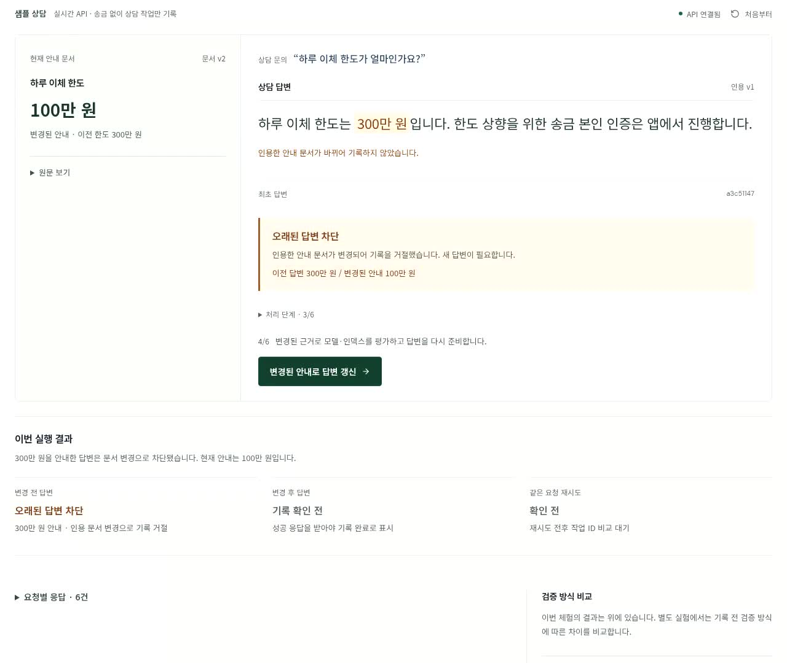
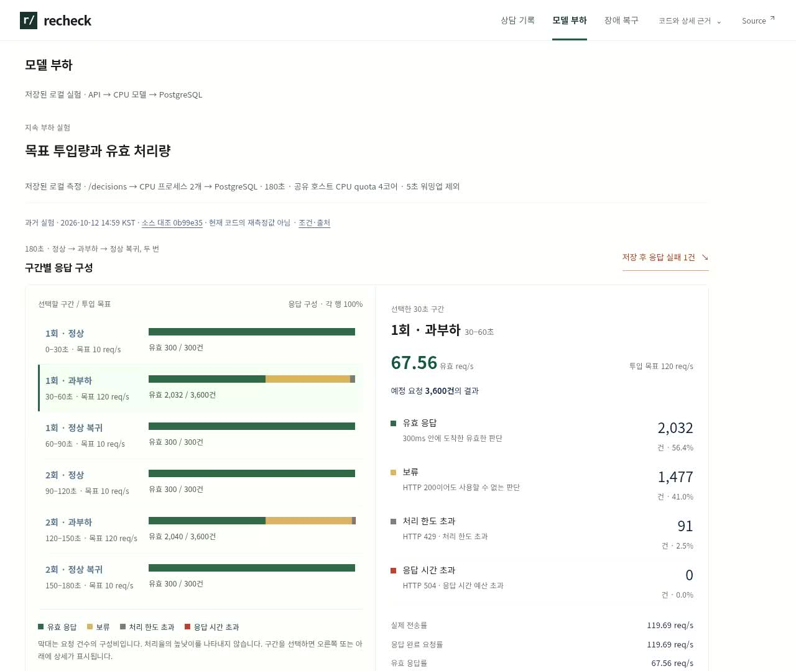
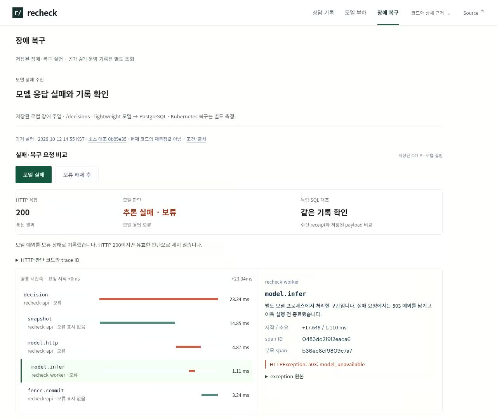

# 이전 UI 시연 교체 기록 · 8b60aa6

이 문서는 이전 UI의 검증 이력입니다. 현재 화면·영상은 [후속 보완 기록](../../usability-feedback-2026-10-19.md#실행-작업과-근거-탐색-보완)을 확인하세요. 이전 영상은 현재 배포에서 제거했습니다.

2026-10-19 08:02:35 UTC 촬영. 시작 소스 `2a67b78562aa0530d0fd3c20c550bca82853d7d9`에 현재 영상 안내·촬영 스크립트 변경을 적용한 작업 트리다. 해당 UI 소스 SHA-256, 영상 파일 SHA-256, HTTP 응답과 작업 ID는 [capture.json](capture.json)에 있다.

## 변경

- 이전 UI MP4/WebM/poster를 현재 배포 트리에서 삭제. 새 `recheck-walkthrough-20261019.mp4`/`.webm`과 poster를 사용해 기존 영상 캐시와 구분한다.
- 로컬 Python API·SQLite의 실제 흐름을 1280×1080, 56초로 촬영했다. 합성 응답·배속 없이 시작 1초만 제거했다.
- 원문 변경→이전 답변 기록 차단→최신 답변 준비→새 작업 기록→동일 키 재시도, 요청 로그 필터, 비교 화면 왕복을 실제 조작했다. 이후 모델 부하·장애 복구의 **저장된 과거 실험** 화면을 보고 돌아와 같은 작업 ID를 확인했다.
- 공개 API 성능을 촬영한 영상이 아니다. 시연 영상 재생과 현재 방문자의 실행 상태는 별개다. 이체 한도는 샘플 상담 문서이며 실제 송금은 없다.

[당시 영상 · 고정 커밋](https://github.com/sokldjs554/recheck-ml-serving/blob/8b60aa640efc6d8c798b4171919297b286639063/demo/public/media/recheck-walkthrough-20261019.mp4) · [실제 요청/응답 원본](case.json) · [외부 프로젝트 조사](../../research/2026-10-19/README.md)







## 재현

로컬 API와 Vite를 실행한 뒤:

```bash
python scripts/record_demo.py --base http://127.0.0.1:5173 --api http://127.0.0.1:8025 --output work/current-recording
python scripts/check_presentation_browser.py --base http://127.0.0.1:5173 --api http://127.0.0.1:8025 --output work/current-recording/presentation
npm --prefix demo test
npm --prefix demo run build
```

Python Playwright·Chromium·ffmpeg가 필요하다. 촬영 스크립트의 안내에 따라 Playwright ffmpeg 경로를 준비한다. 이번 환경은 시스템 ffmpeg를 `PLAYWRIGHT_BROWSERS_PATH` 아래 ffmpeg-1011/ffmpeg-linux로 연결했다.

## 검증

- 로컬 프런트 61개 통과, production build 성공.
- [브라우저 7개 검사](local-presentation.json): 실제 영상 디코딩·재생, health 대기 중 실시간 요청과 영상 구분, API 로그 필터, 1440/768/390/320px 표시, 저장된 6개 부하 구간과 SQL 예외 연결, 실패·복구 trace 상세.
- 영상에서 실제 409 차단 뒤 두 번의 200이 같은 작업 `0e1b3ba1-02bc-4144-a7fc-1fd144239428`을 가리키는 것을 원본 사건 기록으로 확인할 수 있다. 기존 백엔드와 상태 관리 동작은 변경하지 않았다.
- 첫 로컬 브라우저 검사는 개발 서버 연결 종료로 `ERR_CONNECTION_REFUSED`로 중단됐다. 서버 재시작 후 위 검사를 통과했다. 이 실패를 공개 API 장애로 해석하지 않는다.
- 공개 배포와 CI 결과는 아래에 연결한다. 과거 부하 성능을 이번 커밋에서 재측정하지 않았다.

## 배포 버전

- 영상·UI 코드: [`8b60aa640efc6d8c798b4171919297b286639063`](https://github.com/sokldjs554/recheck-ml-serving/commit/8b60aa640efc6d8c798b4171919297b286639063).
- [CI 39221213486](https://github.com/sokldjs554/recheck-ml-serving/actions/runs/39221213486): 성공.
- Render `dep-dbat263m8hqs73bomt6g`: 위 커밋으로 2026-10-19 08:15:11 UTC live. 새로운 유료 리소스나 요금제 변경 없음.

- [공개 Chromium 검사](https://github.com/sokldjs554/recheck-ml-serving/actions/runs/39221213508/job/117956693427): 성공. 새 MP4/WebM 모두 HTTP200·정확한 MIME, 56초 영상 재생, 실제 API 체험과 별도 상태 표시 확인. 완료/중간 복원·재시도·화면 왕복은 [public-chromium.json](public-chromium.json)에 기록했다.
- [검증 로그 발췌](verification.json): 백엔드 159개 통과·1개 제외, 프런트 61개 통과, production bundle과 web_static 일치. 제외 항목을 이번 영상 작업에서 새 검증했다고 세지 않는다.

- [공개 macOS WebKit 검사](https://github.com/sokldjs554/recheck-ml-serving/actions/runs/39221213508/job/117958338785): 9개 통과. [결과 JSON](public-webkit.json). 공개 Chromium 72개(로그 PASS66+서빙 JSON6)와 합해 81개 검사다. 이는 자동화 검사 수이며 실제 사용자 이해도나 모든 기기 지원을 뜻하지 않는다.
