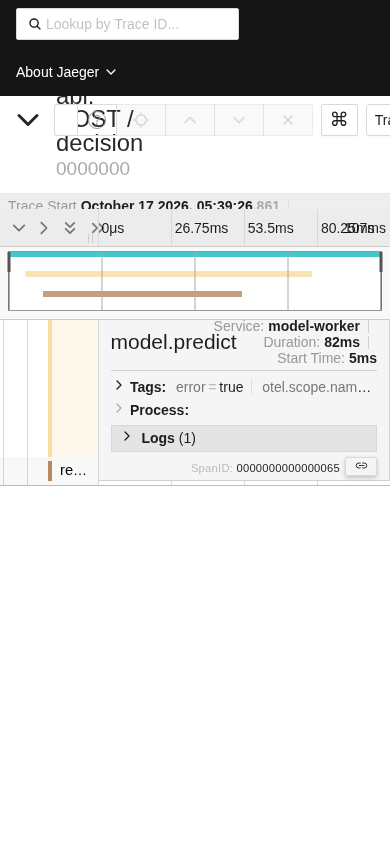
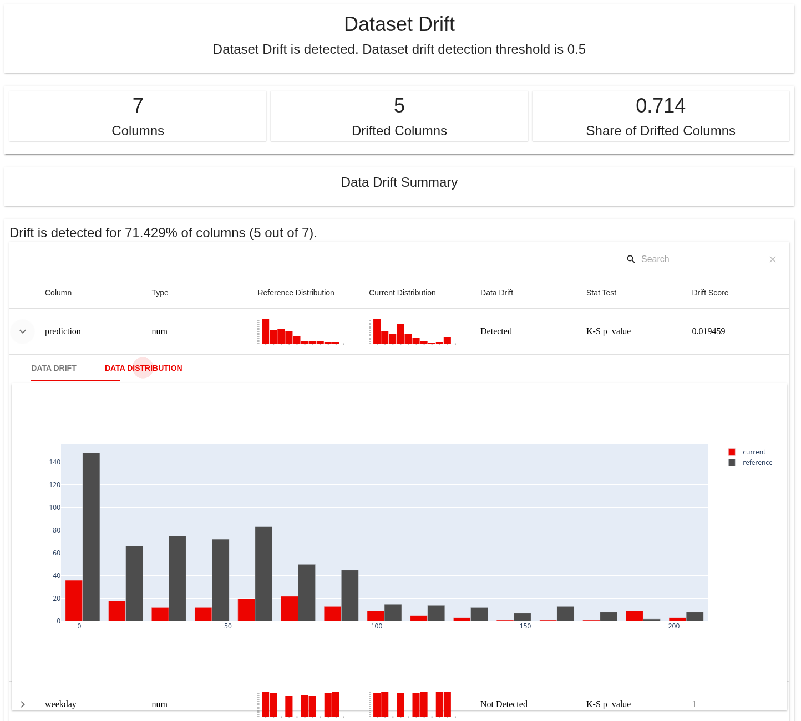
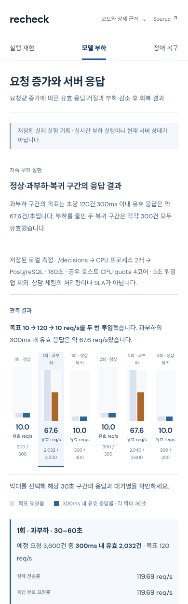

# 실제 브라우저 조작과 화면 비교

2026-10-17 UTC. Headless Chromium `/usr/bin/chromium`, Python Playwright, PC 1440×1000 / 모바일 viewport 390×844. 모바일 실기기·Safari 검증이 아니다. 외부 공개 호스트에 요청 부하를 주지 않았다.

## 실행 환경과 의미

- **Jaeger:** `jaegertracing/all-in-one:1.66.0`, image digest `sha256:9864182b4e01350fcc64631bdba5f4085f87daae9d477a04c25d9cb362e787a9`. [해당 릴리스](https://github.com/jaegertracing/jaeger/releases/tag/v1.66.0). 실제 컨테이너·OTLP 수신·검색 API·UI를 로컬 실행했다. 최신 공개 서비스 버전으로 일반화하지 않는다.
- **입력:** 합성 trace 12개, 각각 API/model/record span 3개, 4개 trace의 root/model에 ERROR를 넣었다. span 시간과 exception은 UI 검사용 fixture다. 실제 모델 timeout·DB commit 실적이나 성능 수치가 아니다. HotROD 앱을 실행한 것도 아니다.
- **Evidently:** [v0.4.40의 공식 저장 HTML 보고서](https://github.com/evidentlyai/evidently/tree/8d50976ad34a30417e51801503af8b0eab574c93/examples/integrations/streamlit_dashboard/projects/bike-sharing/reports/2011-02-12_2011-02-18), data_drift/model_performance 두 파일. 실제 JS UI를 로컬 HTTP 서버로 열어 조작했다. 2011년 bike-sharing 자료가 들어 있는 저장 보고서이며 최신 Cloud 앱이나 신규 모델 평가가 아니다.
- **RECHECK:** 원격 main과 일치한 `ddfb7ccfeba0b4ff36e920cd2cf626d4e19c240c`의 `web_static`을 실행했다. 세 화면·저장된 구간/trace 선택·원본 펼침을 확인했다. 이번 비교에서 공개 API의 상담 실행은 다시 수행하지 않았다.
- 임시 컨테이너와 HTTP 서버는 조사 후 종료했다. 외부 프레임워크 부하 벤치마크는 실행하지 않았다.

## Jaeger: 실제 조작한 상태

| 행동 | 관측 | 해석 |
|---|---|---|
| 데이터 없는 첫 화면 | 서비스 선택 중심, Find Traces 비활성, 오른쪽 큰 빈 영역 | 운영자 도구에는 자연스럽지만 지원 프로젝트의 첫 체험에 그대로 쓰기에는 설명 부족 |
| 서비스 선택 → Find Traces | 12 Traces, 지연 scatter, 서비스별 span 개수, 오류 badge | 요약에서 요청 한 건으로 이동하는 연결이 명확 |
| 실패 요청 클릭 → model.predict → Logs | 같은 화면에서 서비스·상대 시작·소요·ERROR·exception.message 확인 | 로그를 별도 문서로 보낼 필요 없이 시간축과 문맥 유지 |
| URL의 error=true 검색 | 4 Traces. 12건 중 오류 trace만 표시 | 두 error span을 두 실패 요청으로 잘못 세지 않음 |
| 결과 → 상세 → 브라우저 뒤로 | error=true와 4개 검색 결과 유지 | URL에 조건을 둔 탐색 상태 보존 |
| 없는 request.sequence 검색 | `No trace results. Try another query.` | 데이터 없음과 오류 응답을 구분 |
| 잘못된 trace ID 열기 | HTTP400, 요청 URL과 response body 표시 | 실패를 숨기지는 않지만 초보자에게는 기술적 메시지 |
| 390px 상세 화면 | 제목·상단 도구·시간축 겹침, 서비스 이름 잘림 | 문서 폭은 390px여도 내부 clipping/overlap이 있음. scrollWidth 검사만으로 정상 판정하면 안 됨 |

검색 클릭부터 첫 trace 텍스트까지 0.225초가 한 번 관측됐다. fixture 12건·로컬 단일 표본이며 throughput, p95, 실제 운영 성능 비교에 사용하지 않는다. screenshot 대기까지 포함한 다른 elapsed 값도 UI 벤치마크로 쓰지 않는다.

## Evidently: 실제 조작한 상태

| 행동 | 관측 | 해석 |
|---|---|---|
| data_drift 열기 | 전체7열/변화5열/비율0.714, 표에는 기준·현재 분포를 함께 표시 | 분모와 비교 대상을 지표 가까이 유지 |
| prediction 행 펼치기 | 행 바로 아래 DATA DRIFT / DATA DISTRIBUTION | 상세를 열어도 선택한 열과 주변 비교를 잃지 않음 |
| DATA DISTRIBUTION 선택 | current/reference 분포가 같은 축에 표시 | 두 화면을 기억하며 비교할 필요를 줄이는 구조 |
| windspeed 검색 | 해당 행만 남음 | 전체 데이터 설명과 현재 필터 범위를 구분할 필요 |
| 없는 이름 검색 | 일치 행 없음 | 빈 결과 상태 확인 |
| Drift Score 정렬 | 행 순서 변경 | 표의 실제 조작 확인 |
| model_performance 열기 | Current/Reference ME·MAE·MAPE, predicted/actual·시간별·오차 분포 | headline 점수 뒤에 분포와 비교 조건 제공. 이 값을 RECHECK 처리 성능과 비교하지 않음 |
| 390px 보고서 | KPI 3개를 한 줄에 유지해 텍스트 줄바꿈이 큼. 표는 356px 컨테이너 안의 911px 내용으로 가로 스크롤 | 데스크톱 표를 압축한 배치를 RECHECK 모바일에 복제하지 않음 |

두 보고서 초기 렌더에서 pageerror 수집값은 빈 배열이었다. 전체 문서 폭은 PC1444/viewport1440, 모바일394/viewport390으로 4px 초과했다. 렌더 성공과 화면 가독성은 별개다.

## RECHECK: 이미 있는 기능과 남은 화면 문제

- PC 세 화면 document width=1440, 모바일=390으로 문서 전체의 가로 넘침은 관측되지 않았다. 이는 모든 내부 영역·접근성 정상 판정이 아니다.
- 모바일에서 두 번째 과부하 구간 선택, 복구 trace의 model.predict 선택, 원본 조건 펼침이 작동했다. 이 기능을 새로운 개선안으로 다시 제시하지 않는다.
- **실제 computed style:** 모바일 trace 서비스·상태 보조 라벨 8px, 부하 구간·분모 라벨 9px. 정보는 있으나 너무 작게 읽어야 한다. [기록](records/recheck-interaction.json).
- 1440×1000에서 장애 복구 화면의 trace 탐색기는 설명·과정 표 다음에 시작한다. 핵심 도구가 첫 화면 하단으로 밀린다. 모바일에서는 더 긴 스크롤이 필요하다.
- 첫 화면은 목적·3경로·실제 API 표시를 갖췄지만, 모바일에서 소개와 3경로 설명 후에 실행 상태가 나타난다. 상단 버튼이 있다고 결과 위치까지 가까운 것은 아니다.
- 모델 부하 화면은 목표120/유효67.6 구분과 조건을 정확히 적었다. 그러나 설명·주의·요약 수치가 여러 번 반복되고, 막대가 실패 종류를 직접 보여주지 않는다. 보류/거절/504를 읽으려면 상세 문장을 따라가야 한다.
- [`TraceExplorer.tsx`](../../../demo/src/TraceExplorer.tsx)는 렌더 key는 span_id지만 선택은 name으로 find한다. 현재 저장 표본의 이름은 중복되지 않아 관측 오류는 없다. 반복 이름 trace를 추가할 경우 첫 span을 선택하는 잠재 제약이다. 지금 고장 났다고 주장하지 않는다.
- 실패/복구 전환은 trace마다 최대시간을 다시 계산한다. 각 화면에서 정확한 수치는 보이지만 막대 길이만으로 두 요청 지연을 비교하면 안 된다.

## 원본과 재현 경계

[조작별 DOM·폭 기록](records/interaction-records.json), [검색·오류·분포 기록](records/followup-records.json), [RECHECK 세 화면 기록](records/recheck-screens.json), [캡처 해시 목록](screens.json). 이미지는 조사자가 로컬에서 촬영한 화면이며 Jaeger/Evidently의 제품 저작권은 해당 프로젝트에 있다. 합성 trace는 스크린샷 분석용이다. 외부 서버의 SLA·모델 정확도·부하 수용 능력은 이 화면 조사로 입증되지 않는다.
