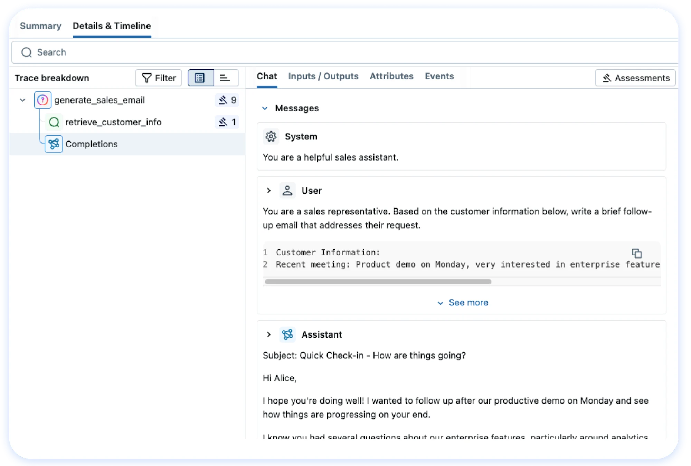
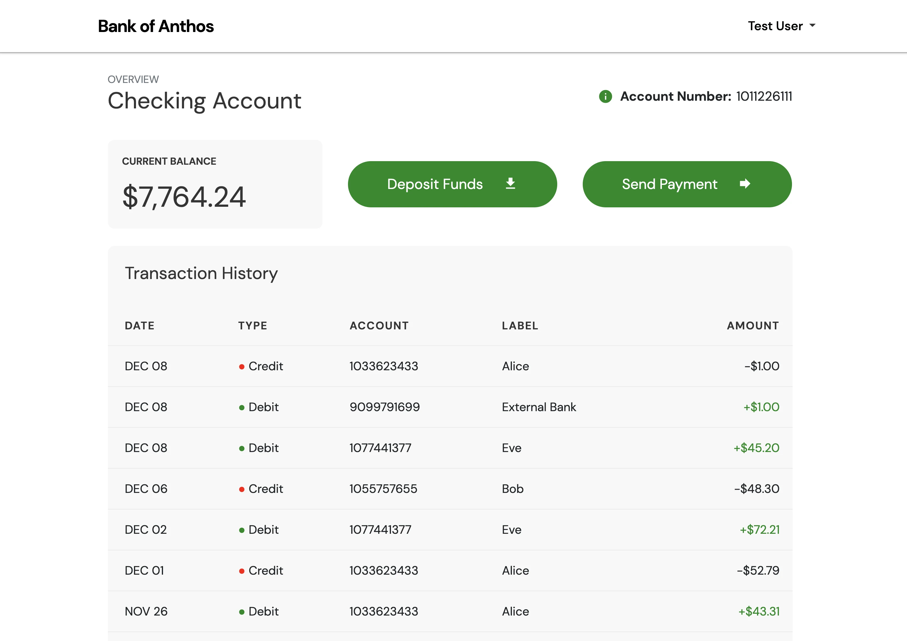
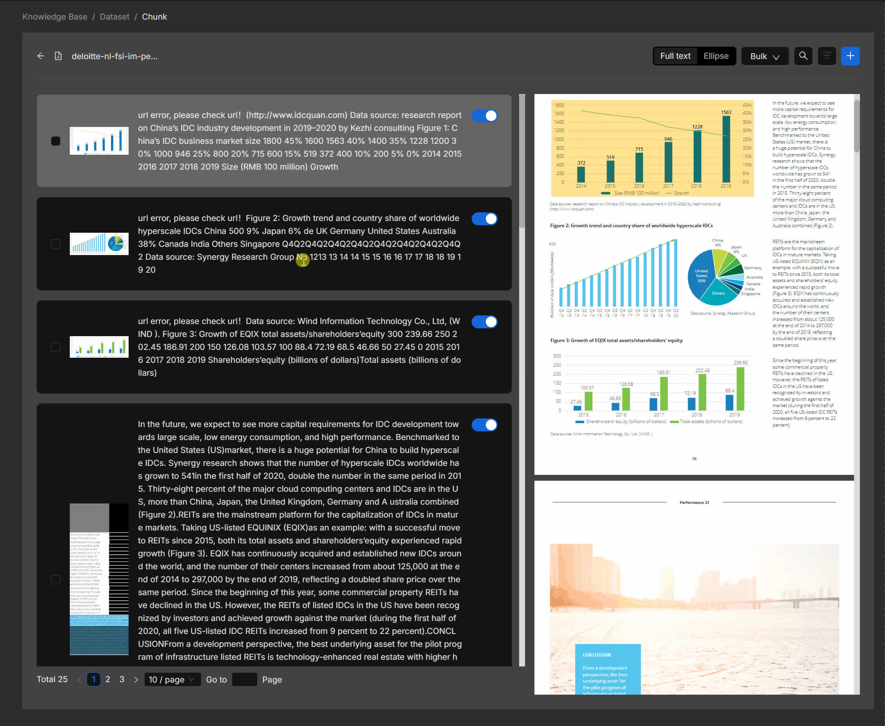
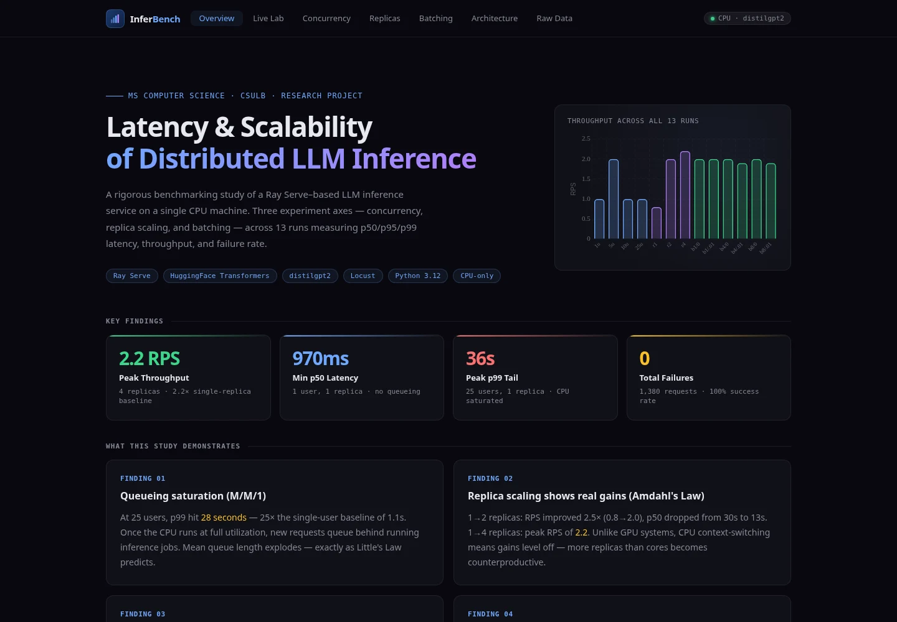
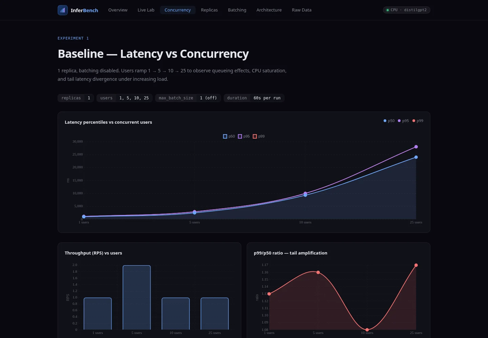
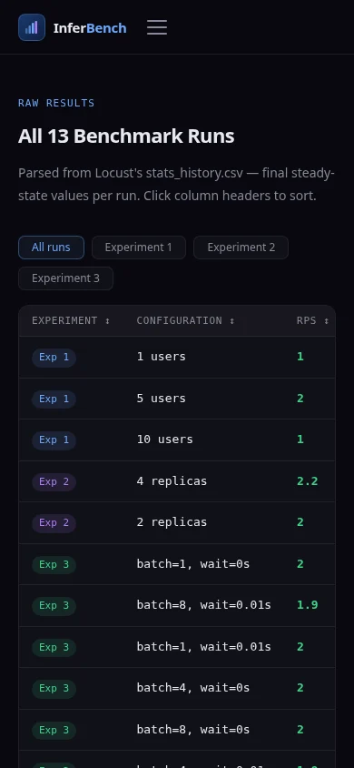

# 공개 프로젝트 비교 조사 — 실행 상태·서빙·추적 중심

2026-10-19 UTC 조사. RECHECK 시작 기준 `2a67b78562aa0530d0fd3c20c550bca82853d7d9`, 작업 트리 변경 없음. 이번 조사는 합격 사례 수집이 아니라 **제품의 작업 단위, 서버 구현, 화면, README, 성능 근거의 연결**을 비교한다. 14개 저장소의 기준 커밋과 README 링크는 [sources.json](sources.json)에 고정했다. 아래 코드 링크도 해당 커밋 기준이다.

## RECHECK에서 먼저 고칠 관점

이체 한도는 문서 변경을 만드는 샘플 데이터다. 프로젝트의 중심은 **모델 결과를 실행할 때 유효성을 다시 확인하고, 중복 없이 기록하며, 부하와 실패를 추적하는 서버**다. 그런데 현재 첫 화면은 `하루 이체 한도`, 큰 금액, 상담 질문을 먼저 보여주고 모델 처리·작업 기록·실패 근거는 후속 화면으로 밀린다. 친구의 “은행처럼 송금”, “검증 결과를 모르겠음”이라는 답변과도 부합하는 문제다. 이 피드백은 한 명의 답변이며, 클릭 경로나 소요 시간을 측정한 사용성 연구는 아니다.

**은행 앱의 외형을 더 닮게 만드는 것이 우선 과제가 아니다.** 실제 송금이 없는 RECHECK에서 잔액·계좌·송금 행동을 강조하면 구현 목적을 잘못 전달한다. 지금 있는 정합성·서빙·복구 근거를, 개발자가 처리할 **작업과 요청**을 중심으로 보여주는 편이 맞다. 이번 변경은 현재 UI 영상 교체와 조사 자료 정리까지다. 아래 UI 방향은 아직 구현·사용자 재검증하지 않았다.

## 확인 수준

- **직접 조작:** 개인 `llm-inference-bench`의 고정 커밋 HTML을 로컬 Chromium에서 실행. 7개 탭, 차트 렌더링, 원본 표 p99 정렬, 390px 배치 확인. 추론 버튼은 호출하지 않았다. Chart.js 4.4.1만 접근 가능한 jsDelivr의 동일 버전으로 공급했다. [조작 기록](static-browser.json)
- **공식 화면 확인:** MLflow README trace PNG, Bank of Anthos README 거래 화면 PNG, RAGFlow 공식 chunking GIF의 3초 프레임. 실제 사이트에서 직접 눌렀다고 기록하지 않는다.
- **공개 접속 시도:** MLflow, Phoenix, Argilla, 개인 추론 데모, RAGFlow, Dify, Cymbal Bank 모두 이 개발환경의 Chromium에서 `ERR_TUNNEL_CONNECTION_FAILED`. 사이트 장애라는 뜻이 아니다. [접속 기록](browser-access.json). 별도 웹 읽기에서는 Dify 로그인 화면, MLflow/RAGFlow/Phoenix의 JS shell까지만 확인했다.
- **코드·문서:** 아래 표에서 지정한 파일과 README를 확인했다. 외부 모델·부하 실험을 재실행하지 않았고 외부 서비스에 부하를 주지 않았다. 접근하지 못한 서비스의 응답 속도나 현재 배포 기능을 추정하지 않는다.
- **기존 조사 재사용:** [10월 17일 브라우저 조사](../2026-10-17/browser-audit.md)는 Jaeger 1.66.0 로컬 실제 컨테이너와 Evidently 0.4.40 공식 저장 보고서 조작 기록이다. 이번에 새로 실행한 것으로 세지 않는다. Langfuse·Phoenix·promptfoo 등의 이전 코드·공식 화면 검토는 [기존 전체 조사](../../deep-comparative-research-2026-10-17.md)에 남아 있다.

## 비교표

| 프로젝트 | 실제 기능·구현 확인 | 화면·README에서 참고할 점 | 성능 근거와 확인 범위 |
|---|---|---|---|
| [MLflow](https://github.com/mlflow/mlflow/tree/ee3c16654baf96ff83ca5e67ac05e0558dc48587) | `ModelTraceExplorerDetailView.tsx`: 선택 span, 시간축 트리, 검색, 크기 조절, 우측 상세 상태 연결 | README가 기능별 실제 화면과 해당 데모 상세 URL을 붙임. trace 트리에서 선택한 연산의 입력·출력·이벤트로 이어짐 | 공개 데모는 샘플 데이터. 처리량 비교 자료로 사용하지 않음. 공식 PNG와 UI 코드 확인, 공개 앱 조작 불가 |
| [vLLM](https://github.com/vllm-project/vllm/tree/852989f580820849113d67d13fd8053e279d0444) | `vllm/benchmarks/serve.py`: request rate, completed/failed, TTFT/TPOT/E2E, 조건을 만족한 request goodput 계산 | 모델 서버의 기능과 벤치마크 명령을 연결. 별도 제품 UI를 제공한다는 전제로 비교하지 않음 | GPU·모델·토큰 길이가 다른 수치를 RECHECK와 비교하지 않음. 계산 코드 확인, 모델 실행 안 함 |
| [Triton](https://github.com/triton-inference-server/server/tree/57b3eba6b5ac9b493747bec0eb8c69f0a0cee7a4) | `docs/user_guide/batcher.md`, `metrics.md`: batch delay·queue policy·실행/요청 카운트·queue/compute 구분 | 처리량을 높일 때 추가 대기 시간을 비용으로 설명. 지표 이름과 측정 범위를 명시 | 문서는 지연 예산 안에서 배치/지연을 조정하라고 안내. 임의 최대 처리량을 가져오지 않음. 서버 재실행 안 함 |
| [BentoSentenceTransformers](https://github.com/bentoml/BentoSentenceTransformers/tree/4190091903523385686fce50b04c926071b37ac4) | `service.py`: all-MiniLM-L6-v2, `@api(batchable=True)`; `locustfile.py`: 1~8 문장 POST, 사용자 대기 0.01~2초 | 짧은 목적 → 설치 → API 실행 → 요청 예 → 배포. 기술 배지 없이 실행 대상이 드러남 | T4 리소스 지정과 CPU fallback이 존재. 부하 생성 코드 자체가 성능 결과는 아님. 일치 조건의 결과표는 확인한 README에 없음 |
| [Made With ML](https://github.com/GokuMohandas/Made-With-ML/tree/3361aeb8ddfc2affdba9f545c978c38c85cee764) | `madewithml/serve.py`: Ray Serve·MLflow checkpoint·`run_id`·확률 threshold 미달 시 `other` | 강의/실습 경로, 실행, 배포·CI 설명을 연결. 요청이 어느 모델 실행에서 나왔는지 확인 가능 | 코드에 replica=1, CPU=8 지정. 이것만으로 실측 성능을 주장하지 않음. 영상 링크는 확인했으나 재생하지 않음 |
| [개인 LLM inference bench](https://github.com/Dababykogitarl/llm-inference-bench/tree/58258bcb0f85b1ae5efebf7048e58b9a62a69b92) | Ray Serve CPU distilgpt2·Locust·CSV·Chart.js 단일 HTML·Vercel proxy. 소스 5개와 CSV 대조 | 실험 변수를 Concurrency/Replicas/Batching으로 나눠 조건→차트→표를 연결. 실제 로컬 화면 조작 | README 60초/32 tokens/13조건, 2.2 RPS·p99 최대36초는 작성자 자료. 배치 설정·요청 수·공개 모델 경로 불일치가 있어 아래 별도 분석 |
| [Restate Agent](https://github.com/restatedev/agent/tree/95a56fdece5cee57fa0df9a327ea1eb72a3a5d29) | `agent/service.ts`, `docs/turn-runtime.md`: Agent의 상태 조정과 AgentSession의 turn 실행 분리, stable operation ID, approval/interrupt/failed 상태 | 답변 텍스트 외에 실행의 소유자·수명·완료 상태가 제품의 핵심 단위 | 처리량 실험은 확인하지 않음. README 영상 링크를 재생한 것으로 세지 않음. 전체 런타임을 RECHECK에 도입할 근거는 없음 |
| [Temporal durable-agent-skills](https://github.com/temporal-sa/durable-agent-skills/tree/c0333fb86fdbeb2010265a921c29b96d0cc16931) | `skills/money_transfer/workflow.py`: 검증→승인 대기→withdraw/deposit, 재시도·멱등 키·실패 보상 | 사용자 작업 상태를 deterministic workflow에 연결. 승인·실행·완료는 별개 상태 | SQLite 가상 은행 예제. 실제 은행 실적 아님. UI는 README 설명만 확인; 실행 안 함. 보상 실패의 로그 처리만으로 상용 정합성을 단정하지 않음 |
| [Dify](https://github.com/langgenius/dify/tree/67887de9e427da2892282ce878d8f53c1c18f080) | `web/app/components/workflow/run/index.tsx`: RESULT/DETAIL/TRACING, 요청 lifetime·sequence로 오래된 응답 무시 | 같은 실행의 결과·조건·추적을 탭으로 연결. 화면 선택과 비동기 결과 수명이 별도 | 공개 사이트는 로그인까지만 확인. 내부 UI를 직접 조작한 것은 아님. 실행 로그의 elapsed time은 부하 처리 용량이 아님 |
| [RAGFlow](https://github.com/infiniflow/ragflow/tree/24889253765b5acc0aaf7651754ef29742bbbfc1) | `retrieval-documents/index.tsx`: 문서 선택→retrieval test, 새 요청 대기 중 기존 목록 유지 | 공식 GIF에서 추출 chunk와 원문 페이지를 나란히 비교. 대상과 근거를 기억에 의존하지 않고 대조 | 공식 GIF 프레임+소스 확인. Cloud 앱 조작/검색 정확도/속도는 측정하지 않음 |
| [Argilla](https://github.com/argilla-io/argilla/tree/5338519accb13ae422f8bf9c0642651c249c49af) | `RecordStatus.vue`: pending/draft/discarded/submitted를 텍스트·색상으로 구분 | 데이터 한 건의 상태를 중심에 둠. 문서의 SDK record 생성과 검토 작업을 연결 | 공개 데모 접근 실패, 공식 첨부 이미지도 HTTP403. 코드·README 기준이며 화면을 봤다고 하지 않음. 데이터 품질 사례는 서버 성능이 아님 |
| [Bank of Anthos](https://github.com/GoogleCloudPlatform/bank-of-anthos/tree/db35fea9fd090150e2398106aadb475576f80d94) | `frontend/templates/index.html`, `loadgenerator/locustfile.py`: 작업 화면과 사용자 동작 기반 Locust. README는 9개 서비스 역할 설명 | 화면은 잔액/입금/지급/거래 내역, README는 화면 다음 구조도. **은행 업무를 실제로 모사하는 이 예제의 작업을 RECHECK에 복제하지 않음** | 공식 PNG 확인. 현재 Cymbal 공개 앱 조작 불가. Locust가 있다는 사실은 특정 SLA 증거 아님 |
| [OpenTelemetry Demo](https://github.com/open-telemetry/opentelemetry-demo/tree/85c2cb253ae3519ef2b3a02984c32614106de5ea) | `src/flagd/demo.flagd.json`: adFailure, aiSlowResponse, failedReadinessProbe, queue/memory 문제 등 명시된 시나리오 | 서비스 작업과 장애 스위치·관측 화면의 목적을 분리. 실패 시나리오의 조건이 숨겨져 있지 않음 | 저장소 설정·공식 문서 확인. 이번에 전체 서비스나 장애 주입을 실행하지 않음. 정상 상품 화면을 운영 안정성 증거로 삼지 않음 |
| [HARI](https://github.com/SKNETWORKS-FAMILY-AICAMP/SKN22-Final-4Team-WEB/tree/5829f8d7f159b2f3196f18906a3bb9874fc01673) | README의 채팅·콘텐츠·음성·롤플레잉 기능 설명과 구조 이미지·설치 경로 확인. 구현 코드 감사 범위 아님 | 대표 이미지→프로젝트 목적→기능→구조→실행. 제출 자료의 배치만 참고 | README의 TTS LSD9.27/similarity0.9636는 작성자 지표이며 서버 RPS가 아님. GPU/외부 키 요구. 라이브 제품·첨부 영상 재생 확인 안 함 |

## 화면에서 구체적으로 확인한 차이

### MLflow: 선택한 요청의 문맥 유지

왼쪽 연산 트리의 선택과 오른쪽 입력·출력·이벤트가 연결된다. 큰 프로젝트 소개 대신 분석 대상이 작업 공간을 차지한다. RECHECK에도 이미 실패 span 선택기가 있으므로 다시 만들 필요는 없다. 정합성 체험의 차단/기록/재시도 결과를 같은 작업 상세에 묶는 배치가 다음 개선 대상이다. 복잡한 트리 전체를 첫 체험에 이식하면 학습 비용이 커지므로 결과 요약과 원본 상세를 분리한다.

### Bank of Anthos: 화면의 행동과 저장소의 설명 분리

공식 PNG에서는 잔액·Deposit Funds·Send Payment·거래 표가 우선이다. 서버 아키텍처는 README로 옮겨져 있다. 참고할 것은 **사용자의 대상과 행동을 먼저 배치하는 원칙**이다. RECHECK의 대상은 돈이 아니라 실행하려는 답변과 내부 작업 기록이므로 이 화면의 금액 강조를 복제하면 안 된다. 공식 이미지가 현재 Cymbal 배포 화면과 같다는 확인은 하지 못했다.

### RAGFlow: 결과와 원문을 같은 맥락에서 대조

왼쪽 추출 chunk, 오른쪽 원문 페이지가 함께 보인다. RECHECK에서는 현재 원문과 답변의 인용 버전, 차단/저장 결과가 같은 작업에 속한다는 점이 드러나야 한다. 큰 `100만 원` 대신 문서 v2/인용 v1의 불일치와 작업 미생성 상태를 우선 표시하는 방향이다. 원본 GIF: [chunking.gif](https://raw.githubusercontent.com/infiniflow/ragflow-docs/refs/heads/image/image/chunking.gif), blob `050c98d549489f622ada0ea6eec723544ca0baa4`. 프레임 확인이며 전체 공개 앱 동작 검증은 아니다.

### 개인 추론 대시보드: 좋은 구조와 근거의 결함을 함께 확인

실험별 탭·고정 조건·p50/p95/p99·원본 표 정렬은 참고할 만하다. 반대로 대형 그라데이션 제목과 동일 크기 KPI 카드는 RECHECK 사용자의 요구와 맞지 않아 채택하지 않는다. 모바일 표가 컨테이너 안에서 잘리는 부분은 가로 이동이 필요하며, overflow 값 하나만으로 읽기 쉬운 화면이라 판단하지 않는다.

성능은 다음 파일을 교차 확인했다: [서버](https://github.com/Dababykogitarl/llm-inference-bench/blob/58258bcb0f85b1ae5efebf7048e58b9a62a69b92/python/serve/ray_serve_app.py), [실험 실행](https://github.com/Dababykogitarl/llm-inference-bench/blob/58258bcb0f85b1ae5efebf7048e58b9a62a69b92/python/experiments/run_experiments.py), [CSV](https://github.com/Dababykogitarl/llm-inference-bench/blob/58258bcb0f85b1ae5efebf7048e58b9a62a69b92/results/raw/_summary.csv), [공개 proxy](https://github.com/Dababykogitarl/llm-inference-bench/blob/58258bcb0f85b1ae5efebf7048e58b9a62a69b92/api/generate.js), [화면](https://github.com/Dababykogitarl/llm-inference-bench/blob/58258bcb0f85b1ae5efebf7048e58b9a62a69b92/index.html).

- 실험 3의 batch/wait는 tag 문자열에는 있으나 각 config에서 실제 서버로 전달되는 것은 replicas뿐이다. 생성 서버에도 batch decorator/대기 설정이 없다. 이 커밋으로는 “CPU에서 배칭이 효과 없다”는 인과 결론을 재현할 수 없다.
- README 요청 수는 1,465, HTML 요약은 1,380, CSV의 `total_requests`는 모든 행에서 0이다. 다른 raw 자료가 있을 수 있으므로 조작을 단정하지 않지만, 이 세 자료는 일치하지 않는다.
- 실험은 로컬 CPU distilgpt2, `api/generate.js`는 Anthropic `claude-sonnet-4-6` 호출이다. Live Lab 설명에는 이 차이가 적혀 있으나 상단 CPU/distilgpt2 표시만 보고 같은 실험으로 오해할 수 있다.
- README의 성공 100%는 시간 예산 내 유효 응답과 다르다. p99 36초가 허용되는지 별도 기준이 필요하다. “CPU 100% 때문에”라는 원인 설명도 이 조사에서 CPU 시계열로 검증하지 않았다.

RECHECK에 적용할 교훈은 **화면·수치·실행 코드의 동일성 확인**이다. 현재 UI와 다른 영상, 별도 CPU 측정을 상담 성능으로 보이게 하는 연결, target120와 useful67.6 혼동을 만들지 않아야 한다. 타 프로젝트의 수치를 RECHECK 대비 개선율로 사용하지 않는다.

## 다음 UI 작업의 우선순위와 비용

| 순서 | 변경 방향 | 유지할 구현·증거 | 비용과 완료 확인 |
|---|---|---|---|
| 1 | 현재 UI 영상으로 교체. 영상은 실시간 요청과 구분 | 이번 실제 API 촬영, 409→200→같은 작업 ID, 부하/복구 저장 자료 | 이번에 반영. 파일명 버전 변경으로 기존 캐시와 분리. 아래 촬영 근거 참조 |
| 2 | 첫 화면을 `실행 기록` 작업 공간으로 구성. 한도 예시는 `샘플 상담` 내부 데이터로 낮춤 | App의 CaseFlow·중복 방지·복원·API 계약 | UI 재배치 필요. 새 모델/서버 교체 불필요. 최초 사용자가 프로젝트를 송금 서비스로 설명하는지 다시 관찰 |
| 3 | 작업 한 건의 `기록 없음 / 새 작업 기록 / 기존 작업 반환`을 중심에 두고, 원문/인용 버전 차이는 바로 옆에 표시 | 현재 CaseStudy의 실제 state/events/action ID | 설명문 추가보다 시각적 순서 조정. 미처리 상태를 완료로 표시하지 않는 회귀 검증 필요 |
| 4 | 같은 실행의 결과→요청별 응답→trace·SQL 근거로 이동. 상담과 CPU 실험 출처는 유지 | 기존 MeasuredReview·Journal·비교 자료 | 출처가 다른 요청을 하나의 trace로 합치지 않음. 이미 있는 선택기·표·원본 링크는 재사용 |
| 5 | README 첫 화면과 실제 현재 시연, 구조도·실험 조건·코드 링크를 일치 | 현 README와 날짜·커밋이 고정된 기존 성능 기록 | UI를 다시 바꾸면 촬영도 함께 갱신해야 함. 화면 개선을 성능 개선이라고 쓰지 않음 |

공고의 핵심은 안정적인 서버 구조, 무거운 모델의 응답 속도/처리량, 분산 추적, 기술 선택 비용이다. [공식 공고](https://toss.im/career/job-detail?job_id=6600650003)를 다시 확인했다. 새로운 금융 기능·LLM·프레임워크를 추가해야 한다는 결론은 이 조사에서 나오지 않았다.

## 이번 반영과 후속 확인

[현재 영상·API 기록·검증](../../evidence/current-recording-2026-10-19/README.md). 이전 영상의 파일과 현재 UI/README 연결은 제거하고 새 파일명으로 교체했다. 조사 대상의 디자인·코드·수치는 제품에 복제하지 않았다. 연구용 화면은 원 출처를 표기했고 제품 화면 자산으로 쓰지 않는다.

다음 UI를 수정한 뒤 친구에게 정답을 알려주지 않고 부탁할 과제:

1. 처음 화면을 보고 이 서비스에서 할 수 있는 일을 말해주세요.
2. 작업을 하나 진행하고, 결과가 어떻게 달라졌는지 설명해주세요.
3. 이전 작업을 다시 확인한 뒤 새 작업이 생겼는지 판단한 이유를 말해주세요.

화면 조작 자동화 통과는 위 질문의 이해도를 입증하지 않는다. 사용자 역할은 주제·방향 결정, 요구 구체화와 수정 요청, 결과 검토다. 이번 조사·코드·영상 제작을 사용자가 직접 수행했다고 제출 자료에 쓰지 않는다.
